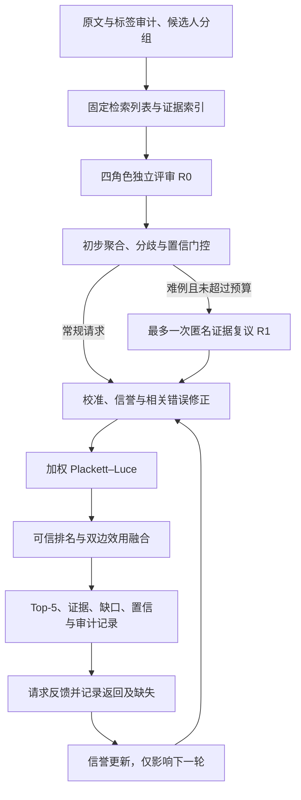

# 实验设置与执行协议

日期：2026-11-11  
状态：实验设计，尚未运行；模型版本、原始数据与实际费用尚未冻结。  
结果记录：[验收与结果矩阵](./acceptance_result_matrix.md)。

本项目研究候选人侧岗位 Top-K 重排。主线为可信聚合、选择性反馈偏差和双边效用；公平作为受控审计，蒸馏与学习路线为 optional。实验以原始匹配标签提供主要外部评价，以独立顶尖模型提供多维代理评价，不将模型标注称为真实人工反馈。

## 1. 设计依据与研究问题

### 1.1 来源及优先级

1. [冻结版 proposal](../proposal/proposal_frozen.pdf)：项目任务与模块边界的主要依据。
2. [导师反馈](../proposal/professor-feedback-on-proposal.docx)：补齐反馈闭环、缺失机制及聚合对照的依据。
3. 本协议：落实本次讨论确定的实验范围与可执行设置。与早期方法草稿冲突时，以本协议为准。

本文是后续执行协议，不表示已取得数据、已确定模型或已得到结果。

### 1.2 三条主线

| 编号 | 研究问题 | 待检验假设 | 主要实验 |
|---|---|---|---|
| RQ1 | 信誉、校准、相关错误修正能否改善岗位排序？PL 是否有额外价值？ | 完整可信聚合优于简单聚合，特别是在评审受污染时；PL 的增益须独立验证 | M1、M2 |
| RQ2 | 选择性反馈如何改变信誉学习与后续推荐？ | 覆盖不均可能使信誉估计失真；探索、覆盖干预与适用条件下的加权更新能够缓解问题 | M3 |
| RQ3 | 双边重排能否在保留可信排序的同时改善联合代理效用？ | 双边目标呈现可解释的效用权衡，且收益不能仅来自牺牲一方 | M4 |

S1 审计受控属性敏感性及反馈覆盖，不据此宣称现实招聘公平。项目不自动申请、录用或淘汰候选人。

### 1.3 原设计的未明确项及处理

| 未明确项 | 原文分析 | 本协议决定 |
|---|---|---|
| PL 定义 | Proposal 第 17–18 页已明确为 Plackett–Luce；feedback 将其理解为 probabilistic linguistic | 明确更正术语理解，保留 PL，并设置相同权重平均分对照 |
| 信誉针对什么目标 | Proposal 将信誉与效用分开，但未明确各角色是否预测相同事件 | 四个角色增加共同匹配预测头，仅以同一种原始标签学习信誉 |
| 角色分歧与预测错误 | 成长、偏好、雇主侧目标本来就可能不同 | 不把角色维度评分直接对照 accept/reject，不把合理偏好差异当作错误 |
| 反馈内容和时点 | Proposal 有人工升级出口，但没有完整更新协议 | 先预测、再请求、再返回、再更新；更新只影响下一轮 |
| 模型标注的地位 | 顶尖模型也可能偏置或与 panel 同源 | 独立模型、独立输入、独立结果；只称代理标签 |
| 最终重排覆盖前序模块 | 只按新的双边分数排序会抹去 PL 排名 | 最终分数显式保留可信排名，消融其融合比例 |
| 异常过滤 | 四个评审下 MAD 不稳定，异常意见可能是正确少数 | 主方法不自动删除意见，MAD 仅作附加消融 |
| 公平目标 | 个体属性敏感性、群体机会与反馈覆盖不是同一指标 | 分开报告；缺少参考标签时不做现实群体曝光优化 |

贡献定位为共同目标上的可信聚合、反馈选择机制和双边代理效用的实证研究。PL、角色化 Agent 和一般信誉加权本身不作为新的算法贡献。

## 2. 数据与标签

### 2.1 数据获取及启动门槛 G0

首选 AliTianChi 原始数据，次选 IntelliPro；一个数据集完成全部主实验即可，第二数据集为扩展。ConFit 是方法与代码仓库，不是第三个独立数据集。

[ConFit 官方仓库](https://github.com/jasonyux/ConFit#data)说明公开正文使用占位符，原始数据须申请。因此，克隆仓库或读到字段样例不等于获得可用实验数据。本协议不授权代发联系作者的邮件。

获取原文后先生成数据审计报告，核查：

- 候选人 ID、岗位 ID、真实简历与 JD 正文是否齐全，是否仍有占位内容。
- 标签的来源、时间和流程语义，特别是 0、-1、null、未交互是否不同。
- 每名候选人的已标注不同岗位数、正负例数和标签冲突。
- 简历与 JD 的重复、近重复、身份变体以及跨 split 重叠。
- 显式偏好、城市、行业、岗位类型、时间戳和人口属性的实际可用性。
- 匿名字段是否只能比较编码一致性，不能解释编码的自然语言含义。
- 数据授权和第三方模型处理限制是否允许拟采用的评审方式。

[ConFit 原论文](https://arxiv.org/html/2401.16349)将常见二元标签描述为是否被岗位接受参加面试。实际数据仍须核实；不得把 accept 自动解释为获得 offer、实际入职或候选人满意。

### 2.2 规模与分组划分

| 档位 | 合计候选人数 | 校准集 C | 验证集 V | 反馈流 F | 测试集 T | F 的轮数 |
|---|---:|---:|---:|---:|---:|---:|
| 标准档 | 600 | 120 | 80 | 200 | 200 | 5 × 40 |
| 缩减档 | 400 | 80 | 40 | 160 | 120 | 4 × 40 |

主实验查询的合格条件：至少有 10 个不同岗位的明确二元标签，且按下述规则选定的 10 岗位列表同时含正负例。

- 合格候选人达到 600：使用标准档；400–599：使用缩减档。
- 少于 400：G0 不通过，不执行完整主矩阵；只报告数据可行性和明确标记的机制试验。
- 不将未知标签改成负例，不用模型补标凑足原始标签主实验。
- 固定数据种子 `20261111`，按候选人身份分组并按可用行业分层。近重复简历和变体不得跨 split。
- 岗位可跨候选人出现；报告跨 split 岗位 ID 和近重复 JD 的重叠率。
- 同一候选人只贡献一个主查询。未使用的合格候选人保留为未触碰储备，不用作反复择优的测试集。
- 本阶段不训练检索器或模型参数，无独立训练集。C、V、F、T 的职责不得互换。

### 2.3 两条评价轨道

#### 轨道 A：原始标签主实验

对每名候选人，在其**已有明确标签的岗位池**内按 BM25 取前 10 个岗位，所有方法重排同一列表，输出 Top-5。

BM25 使用同一份去敏、标准化文本和固定分词配置，候选人文本为 query；检索不使用标签值。取定列表后排除全正或全负查询，报告各类筛选数量和比例。检索分数相同则按稳定岗位 ID 排序。

该轨道是“已标注岗位池内的重排基准”，不是全岗位库召回实验。已知标签池本身受到历史交互选择影响，结果仅对筛选后的条件分布成立。

二元标签只提供正例优于负例的部分关系。同标签岗位之间不制造真实全序，不用模型评分替换其原始标签。

#### 轨道 B：完整岗位库 pipeline 检查

从 T 固定抽取 50 名候选人，BM25 从完整岗位库召回 Top-10。检查完整输入、评审、聚合、重排及输出记录能否运行。

未标注岗位保持 unknown。报告已判断覆盖率和技术运行结果；若预算允许，另做独立模型代理标注。不与轨道 A 的排序指标混合，不用部分标签声称完整召回率。

### 2.4 三种标签来源

| 来源 | 允许用途 | 不允许的解释 |
|---|---|---|
| 原始 accept/reject | 共同目标校准、信誉更新、轨道 A 排序评价 | 真实候选人满意度或长期成长收益 |
| 独立顶尖模型多维标注 | 候选人效用和可达性的代理评价、解释支持度抽检 | 人类 ground truth、真实反馈或真实接受概率 |
| 受控反馈返回机制 | 检验选择机制、覆盖与信誉演化 | 现实平台的因果效果或已消除历史选择偏差 |

Agent 输入不包含标签、是否为正例、标签来源文件名或其他泄漏标签的字段。T 和 F 的隐藏标签由评价/反馈模拟器管理。

### 2.5 独立模型标注协议

使用两个不同模型家族的顶尖标注模型 T1、T2；二者均不参与被测 panel。正式运行前在配置中记录确切模型 ID、版本日期、生成参数和价格依据。

标注范围为 V 和 T 的全部轨道 A 查询。两位标注者独立运行，只接收去敏候选人资料、显式偏好与 JD，不接收原始标签、panel 输出、方法身份或对方标注。岗位输入顺序分别随机化，输出恢复为稳定 ID。

| 维度 | 0 | 1 | 2 | 3 |
|---|---|---|---|---|
| 技能适配 | 明确不满足关键要求 | 明显缺口较多 | 大部分要求有支持，仍有缺口 | 核心要求有充分证据支持 |
| 偏好满足 | 明确违反显式偏好 | 多项冲突 | 大体满足，少量冲突 | 充分满足已给出的显式偏好 |
| 成长价值 | 有明确的路径冲突或难以达成的跃迁 | 成长有限或迁移风险高 | 存在合理学习与迁移空间 | 与当前基础衔接且有清晰成长空间 |
| 雇主侧可达性 | 明确未满足关键要求 | 达到要求的证据较弱 | 大体可达但有不确定性 | 就文本要求而言具有较充分可达性证据 |

- 信息不足用 `unknown`，不能用 0 代替；不得从学校声望、姓名、性别等线索补出能力或偏好。
- 每个非 unknown 评分须提供输入内的证据定位和简短判据；成长与可达性评分仍是文本代理。
- 保留 T1、T2 原始评分和理由。逐维度两者均已知时取均值；只有一者已知则保留单方值并标记单标注来源；两者都未知则为 unknown。
- 相差至少 2 级或一方 unknown 时标记分歧，不删去该样本，也不强制请第三个模型裁决。
- 报告逐维度一致率、加权 kappa、unknown 率和大分歧率。分别使用 T1、T2 作为参考重复计算代理指标。
- 原始标签主结果始终包含这些分歧样本；高一致性子集仅作为附加分析。

## 3. 系统 pipeline 与方法设置

### 3.1 模型与角色

四角色使用同一个基础模型 P、不同角色提示词，冻结模型参数；T1、T2 只用于独立标注。实际模型标识须通过 pilot 后冻结，不在尚未确定可调用端点时假填版本。

| 角色 | 专长分析 | 必须共享的预测目标 |
|---|---|---|
| Skill | 技能证据、关键缺口 | 原始标签定义的匹配事件 |
| Trajectory | 技能迁移、成长与跃迁风险 | 同上 |
| Candidate Preference | 显式地点、行业、岗位类型等偏好 | 同上 |
| Employer-side | 岗位要求与文本可达性 | 同上 |

每个角色对 10 个岗位输出共同匹配概率 `p_match`，按该预测给出 Top-5，同时输出独立的角色评分、证据、缺口和未知项。角色不访问其他评审结果。

偏好、成长等维度评分不直接参与原始标签的 Brier 计算。通过验证集选出的“最佳角色”仅为描述性单角色参照，不在测试集选最佳 Agent。

Fairness/Audit 是独立审计职责，不产生第五张普通选票。主流程使用可定位证据检查、字段检查和统计审计；不对所有请求额外调用一个 LLM 审计者。

### 3.2 概率校准与信誉

对角色 a 的共同匹配概率截断至 `[10^-4, 1-10^-4]`，转为 logit z，并拟合温度：

`p_tilde = sigmoid(z / T_a)`。

温度通过 C 的原始二元标签最小化 NLL，搜索范围 `T_a ∈ [0.05, 20]`。按候选人做三折交叉拟合，以样本外概率估计 Brier 和残差相关性；用于 V、F、T 的温度由完整 C 拟合。单一综合评审基线单独拟合其温度。

查询 x 的 Brier 为其 10 个岗位平方误差的均值；全局 Brier 对查询等权，避免把岗位对组合数误当成独立样本数。

- 领域 d 使用数据已有行业字段：取查询中岗位行业的众数，平票按稳定编码排序；缺失则使用全局值。
- C 中至少有 30 名候选人的领域才启用领域信誉。
- 领域 Brier 向全局收缩：`BS_shrunk = (n_d * BS_d + 20 * BS_global) / (n_d + 20)`。
- 可靠度：`r_a,d = exp(-BS_shrunk / tau_r)`。
- 残差为 `e_a = p_tilde_a - y`，在相同查询/岗位上计算相关矩阵；常量残差的非对角相关设为 0，记录该退化情况。
- 冗余惩罚：`h_a,d = 1 + lambda_c * sum_b!=a max(0, rho_ab,d)`。
- 样本确定度：`q_a,x = mean_j max(p_tilde_a,x,j, 1-p_tilde_a,x,j)`，范围 `[0.5,1]`。这是待检验的权重因子，不自动解释为“本次排名正确率”。
- 未归一化权重：`w_bar_a,x = r_a,d * q_a,x / h_a,d`，有效评审之间归一化。

默认 `tau_r=0.25`、`lambda_c=1`。在 V 上搜索 `tau_r ∈ {0.1,0.25,0.5}`、`lambda_c ∈ {0.5,1}`、`lambda_s ∈ {0.01,0.1,1}`，以 nDCG@5 选定；平票先选距离默认设置最近的配置，再按数值字典序。配置只选一次，M2、M3、M4 不重新按测试结果调参。

### 3.3 加权 PL 与异常消融

每个评审仅提供前 5 名的部分排序，剩余 5 岗位在 PL 似然分母中保留，但不要求尾部内部有序：

`s_hat = argmax_s [sum_a w_a,x * log P_PL(top5_a | all10, s) - lambda_s * ||s||²]`。

使用稳定 log-sum-exp 计算，按 s 降序输出；数值平票按稳定岗位 ID，不按输入位置。优化器未收敛必须记录，不能静默使用未完成迭代的结果。

主方法不删除异常意见。MAD 附加版本仅允许一次删除、一次重估：初始解下计算每位 Agent 的平均每位置负 log-likelihood；超过 `median + 2.5 * MAD` 的最多一位 Agent 被删除；MAD 为 0、有效评审不足 4 或无人超阈值则不删除。并列最高损失按固定角色顺序处理。该版本不作为安全保证，须统计正确少数意见的误删。

### 3.4 门控复议

M1、M3、M4 的主要因果归因比较使用独立评审 R0 缓存。复议在 M2 的独立协议块中评价，不将额外调用混入聚合增益。

- 分歧 D：评审 Top-5 转换为两两关系，比较双方均有明确先后关系的岗位对；有序头优于未排序尾，尾部两岗位不比较。对 Agent 对计算不一致比例，再取中位数。
- 置信 Q：有效 Agent 的 q 的均值。
- 阈值来自 C：D 的第 75 百分位、Q 的第 25 百分位。`D>D75` 或 `Q<Q25` 触发候选门控。
- 每个独立评价块最多 40% 查询复议；候选超额时按 D 降序、Q 升序、查询 ID 排序取前额定数量。流式实际运行不使用未来请求，该上限在离线实验块上施加。
- 找出分歧最大的岗位对，仅把双方的输入证据片段匿名发送给两个相关 Agent；不发送身份、完整排名或多数意见。
- 每位 Agent 最多修订一次，保存 R0 和 R1；拒绝修订也保留记录。
- R1 发生概率分布变化，不能默认 R0 温度对其仍校准。C 中有至少 30 个复议查询时，对被修订输出单独交叉拟合 R1 温度；不足时沿用 R0 并标记“未独立验证复议校准”，不宣称其置信已校准。

固定复议对照同样只允许两个相关 Agent 修订一次；同时报告其全量运行成本及按门控调用预算截断后的效果。

### 3.5 双边效用与最终重排

推理时：

- `U_C_pred` 为 Skill 的技能评分、Trajectory 的成长评分、Preference 的偏好评分除以 3 后的可用维度均值，维度等权。
- unknown 不按 0 计；全部未知时内部使用 0.5 维持可运行，并标记 `utility_unknown=true`。
- `U_E_pred` 为 Employer-side 经校准的共同匹配概率，仅代表原始流程事件的代理。
- 已知显式约束单独输出违反标记。没有被明确表述为硬约束的期望城市、期望行业不自动升级为淘汰条件。

令可信排名归一化为 `R_trust(j)=(10-rank_trust(j))/9`，令：

`F_lambda(j) = lambda*log(0.01+U_C_pred(j)) + (1-lambda)*log(0.01+U_E_pred(j))`，

`F_norm(j) = (F_lambda(j)-log(0.01)) / (log(1.01)-log(0.01))`，

`S(j) = alpha*R_trust(j) + (1-alpha)*F_norm(j)`。

主设置 `alpha=lambda=0.5`；敏感性网格 `alpha∈{0,0.5,1}`、`lambda∈{0,0.25,0.5,0.75,1}`，全部基于缓存重排。`alpha=0` 用于观察完全覆盖可信排名的后果，`alpha=1` 为原可信排名。

最终输出 Top-5 及预测效用、证据、缺口、未知项、Agent 权重和各阶段名次。预测效用不能直接用作方法有效性的评价真值。

### 3.6 最小数据接口

接口为实验文件契约，不是外部服务 API。正式执行时以 JSONL/JSON 存储，所有记录含 `run_id` 与配置哈希。

| 记录 | 最小字段 |
|---|---|
| `QueryRecord` | query/candidate ID、10 个 job ID、split、规范化输入哈希、证据索引、领域；标签位于独立受限文件 |
| `AgentReview` | query ID、角色、模型版本、revision_round、逐岗位 p_match 与维度评分、Top-5、证据位置、缺口、未知项、解析状态 |
| `TrustSnapshot` | 可用反馈截止轮次、T、BS、领域样本量、r、相关矩阵、超参数 |
| `FeedbackEvent` | 请求轮次、返回状态、来源、选择概率、可观察返回概率、实际可更新轮次；oracle 参数另存 |
| `RankingRecord` | 聚合与最终排名、逐岗位分数/效用、权重、审计标记、fallback、收敛状态 |
| `RunManifest` | 输入版本、模型与提示词版本、所有种子、调用/费用日志、运行时间与代码版本 |

## 4. 主实验矩阵

### 4.1 M1：可信聚合与 PL 必要性

全部使用轨道 A、同一列表和 R0 输出。聚合方法之间复用评审记录。

| ID | 方法 | 目的 |
|---|---|---|
| M1-B0 | BM25 原排序 | 检索参照 |
| M1-B1 | P 单次综合评审 | 单次判断参照 |
| M1-B2 | P 四次独立综合评审，等权 PL | 与四角色等调用次数的参照 |
| M1-B3 | 四角色校准概率的等权平均 | 简单分数融合 |
| M1-B4 | 四角色等权 Borda | 简单排名融合 |
| M1-B5 | 四角色等权 PL | PL 基础参照 |
| M1-B6 | 全局 Brier 信誉加权 PL，q=h=1 | 常规历史信誉参照 |
| M1-B7 | 领域信誉 PL，q=h=1 | 领域条件化贡献 |
| M1-B8 | 领域信誉+相关性 PL，q=1 | 相关性修正贡献 |
| M1-P | 校准+领域信誉+相关性+样本确定度 PL | 主方法 |
| M1-C1 | 使用 M1-P 完全相同权重的校准概率平均 | 区分权重贡献与 PL 贡献 |
| M1-A1 | M1-P 不做温度校准，其他量按未校准概率重算 | 校准消融 |
| M1-A2 | M1-P 去掉样本确定度，即 M1-B8 | 置信权重消融，复用同一结果 |
| M1-A3 | M1-P 去掉相关性修正 | 冗余修正消融 |
| M1-A4 | M1-P 加一次 MAD 删除与重估 | 异常控制附加实验 |

Borda 对 Top-5 分别记 10、9、8、7、6 分，未排序尾部各记 3 分，即剩余 1–5 分的平均值；不制造尾部全序。四次综合评审与四角色使用相同单次 token 上限、相同输入与温度，报告实际 token，而非仅以调用数宣称等成本。

三项预先指定的主要统计比较：`M1-P vs M1-B5`、`M1-P vs M1-B6`、`M1-P vs M1-C1`。

### 4.2 M2：鲁棒性与复议

| ID | 因素 | 设置 |
|---|---|---|
| M2-R1 | 随机错误 | 受污染记录的岗位概率随机重分配，并重建自洽 Top-5 |
| M2-R2 | 高置信错误 | 选定记录的共同概率翻转并推向 0.01/0.99，重建排名 |
| M2-R3 | 定向提升 | 固定选择该查询 BM25 最高的已知负例，将其提至首位并给 0.99 概率 |
| M2-R4 | Clone/Sybil | 在四角色 panel 中注入 1 或 3 个同源评审副本，不增加真实信息 |
| M2-C0 | 无复议 | R0 输出 |
| M2-C1 | 固定复议 | 每个查询最多一次双 Agent 匿名证据修订 |
| M2-C2 | 门控复议 | 按 3.4 节选择查询，上限 40% |
| M2-C3 | 错误证据压力测试 | 固定 50 个难例，复议消息中注入一个与原始输入矛盾的主张，观察传播 |

R1–R3 的污染率为全部测试 `AgentReview` 记录的 `{0,10%,20%,30%,40%,50%}`。每种攻击、每个种子先生成一份共同污染记录，再供所有聚合方法使用。报告每查询 0/1/2/3/4 个被污染角色的分布；全局污染比例不等于单请求恶意占比。

污染作用于 R0 的原始预测记录，随后使用已经冻结的校准与信誉参数处理；不得使用受污染测试标签重新校准。Clone 的同源预测、温度与历史信誉复制自指定来源，新增名义身份后重算 panel 的相关性惩罚与归一化权重。该设置检验重复身份对聚合影响，不代表已经解决未知新 Agent 的冷启动认证。

R4 复制固定攻击源的全部输出，使其形成虚假多数；分别记录注入副本前后，该来源的总权重与定向负例排名。相关性修正不被预设为能够抵御任意副本数量。

复议错误证据不篡改规范化源文档，只改变消息，且所有攻击文本保存以供核验。正确少数意见定义为 R0 中对某个标签不同岗位对判断正确、但其他有效角色多数判断错误的意见，统计其被反转或删除的比例。

主要对照为 M1-B3、M1-B5、M1-B6、M1-P；MAD 版本另报。纯记录污染与 Clone 复用缓存，复议才产生新增调用。

### 4.3 M3：选择性反馈与信誉演化

每轮有 40 名未见过的 F 候选人，先生成全部预测，随后最多请求 10 个列表的反馈；返回一份反馈即揭示该查询 10 个岗位的原始标签。所有策略共享初始输出、分组和随机数。

F 中按行业分层后用固定种子生成两组实验群体，每轮各 20 人；T 中对应平衡划分。分组不提供给排名 Agent，仅供反馈分配与审计使用。它是受控分组，不能称为真实受保护群体。

| ID | 策略 | 每轮请求分配 | 信誉更新 |
|---|---|---|---|
| M3-F0 | Frozen | 与 Uniform 相同，但返回标签不进入更新 | 固定初始信誉 |
| M3-F1 | Uniform | 40 人中均匀无放回抽 10 人 | 普通更新 |
| M3-F2 | Targeted | 6 个最高不确定请求+其余 34 人中随机 4 人 | 普通更新 |
| M3-F3 | Targeted+IPW | 与 F2 相同 | 选择与返回概率加权 |
| M3-F4 | Coverage | 每组取 3 个最不确定请求+该组其余 17 人中随机 2 人 | 普通更新 |
| M3-F5 | Coverage+IPW | 与 F4 相同 | 选择与返回概率加权 |

不确定度定义为 `1-Q`；平票按查询 ID。选择概率是完整策略下的边际纳入概率：Uniform 为 `10/40`；Targeted 的确定 6 人为 1、其余为 `4/34`；Coverage 的各组确定 3 人为 1、其余为 `2/17`。不能把某次随机抽样的条件概率误记为全体的边际选择概率。

| 机制 ID | 返回机制 | 返回概率 | 可声称的校正范围 |
|---|---|---|---|
| M3-N0 | 随机缺失 | 0.8 | 已知受控机制下的校正 |
| M3-N1 | 群体相关缺失 | G0 为 0.9，G1 为 0.3 | 已知受控群体机制下的校正 |
| M3-N2 | 结果相关缺失 MNAR | `0.2+0.6*该查询正例比例` | 真实概率仅模拟器知道；精确概率校正须标记 oracle |

对 N0/N1，IPW 使用 `min(10, 1/(p_select*p_return))`。对 N2，同样使用精确生成概率的 F3/F5 一律标为 oracle，不作为真实系统可直接实现的校正效果。其余策略不访问未返回标签或隐藏返回参数。

每个 Agent 初始化 `N_0=20`、`S_0=20*BS_C`。每轮计算查询级 Brier，并更新：

`S_t = 0.9*S_(t-1) + sum_(returned x) omega_x*BS_x`，

`N_t = 0.9*N_(t-1) + sum_(returned x) omega_x`，`BS_t=S_t/N_t`。

普通更新的 omega=1；IPW 使用上述截断权重。已获支持的领域按同样规则维护统计，未获支持领域继续回退全局。温度、相关矩阵、q 定义和其余超参数固定，只有信誉随反馈变化。

每轮更新后由独立评价程序计算固定 T 上的指标；测试标签不可进入策略、更新或超参数选择。T 的多轮曲线用于预登记评价，不根据曲线反复改策略。若没有时间戳，本实验称序贯回放，不称真实时间泛化。

请求预算相同不代表返回数量相同：必须同时报告请求次数、实际返回数及每份反馈的成本。仅有群体返回率差异不必然导致准确率差异；若没有观察到误差放大，应报告未支持该假设，不人为制造结论。

该实验只能研究已有标注池中模拟的新增缺失，不能消除原始招聘数据已存在的历史选择偏差。

### 4.4 M4：双边效用

全部方法使用相同轨道 A 查询、相同预测效用、相同原始标签和独立模型评价标签。

| ID | 方法 | 排序分数 |
|---|---|---|
| M4-U0 | 可信排名原顺序 | R_trust |
| M4-U1 | Candidate-only | U_C_pred |
| M4-U2 | Employer-only | U_E_pred |
| M4-U3 | 线性双边 | 0.5*U_C_pred+0.5*U_E_pred |
| M4-U4 | 纯 Nash | F_lambda，lambda=0.5 |
| M4-P | 可信排名+Nash | S，alpha=lambda=0.5 |
| M4-S | 敏感性网格 | 3 个 alpha × 5 个 lambda；重复配置复用 |

评价用 `U_C_ref` 为独立标注的技能、偏好、成长三个归一化维度的可用均值；不使用 panel 的预测评分作真值。主代理评价在 T1/T2 汇总后，列表内 10 岗位均至少有一个已知维度的共同查询子集上进行，报告该子集覆盖率；同一个子集用于所有方法。对 T1、T2 单独计算时，各自固定其完整可评子集，不能将不同子集上的差异解释为方法变化。

原始 accept 标签作为雇主流程结果参考。至少报告双方分项、乘积型联合代理和 Nash 代理福利，不能只报一个综合数值。

偏好敏感性另在至少存在一个显式偏好字段的查询上报告。没有偏好字段时，不宣称完成个性化偏好验证。

### 4.5 S1：公平与审计

固定抽取 30 个测试查询，创建 male/female/neutral 三种受控属性表达。能力、经历、偏好、岗位列表和输入顺序保持一致。

- S1-A：属性表达可见，比较四角色及最终排名的变化。
- S1-B：去敏 pipeline；三种变体规范化后输入相同则复用缓存，报告输入哈希一致性，不能将“相同输入得到相同缓存输出”当成新的模型无偏证据。
- 报告 Top-5 集合变化、平均绝对名次差、Top-5 曝光位置变化及代理效用差。
- 反馈覆盖公平直接使用 M3 请求率、返回率与分组误差，不混用两种公平概念。

缺少真实群体属性、可靠机会参考标签和市场容量时，不做现实群体曝光优化，不计算市场稳定性或 blocking pairs。

## 5. 评价口径、统计与验收

### 5.1 指标定义

令位置折扣 `v_k=1/log2(k+1)`，`V5=sum_(k=1..5) v_k`。以下所有方法使用相同评价分母。

| 指标 | 计算口径 |
|---|---|
| nDCG@5 | gain 为原始二元 y；理想排名来自同一个 10 岗位列表，不用模型排序作理想序 |
| Recall@5 | Top-5 正例数/该 10 岗位列表内全部正例数，称池内 recall |
| Hit@5 | Top-5 是否至少有一个正例 |
| Pairwise accuracy | 仅评价标签不同的岗位对；同分预测记 0.5，不构造同标签内部真序 |
| Brier | 先逐查询对 10 岗位均方误差取均值，再按候选人平均 |
| ECE | 10 个等频桶；报告实际样本数，重复预测不当作独立候选人 |
| 权重集中度 | sum_a w_a²；Clone 另统计同一来源的总权重 |
| 有效信息量诊断 | 可附报 1/(w'Rw)，须注明相关矩阵估计与退化情况，不将其解释为严格独立票数 |
| 污染退化 | `1-nDCG_p/nDCG_0`；nDCG_0=0 时为 NA |
| 定向 ASR | 指定已知负例进入 Top-5 的查询比例，同时报告未攻击时的自然入榜率 |
| 经验 breakdown | 首个相对退化达到 20% 的已测污染点；未达到记 >50%，不是安全保证 |
| 反馈覆盖 | 请求数/可请求数；返回数/请求数；收到反馈的查询数/全部查询数 |
| IPW 有效样本量 | `(sum omega)²/sum omega²`，并报截断比例 |
| 信誉误差 | 当前 BS 估计与评价程序在 T 上测得的同目标 BS 之绝对差；不声称得到真实总体信誉 |
| 候选人代理效用 C@5 | `sum_k v_k*U_C_ref(pi_k)/V5` |
| 原始结果 E@5 | `sum_k v_k*y(pi_k)/V5` |
| 联合代理 J@5 | `sum_k v_k*U_C_ref(pi_k)*y(pi_k)/V5` |
| Nash 代理 W@5 | `sum_k v_k*[0.5*log(.01+U_C_ref)+0.5*log(.01+y)]/V5`，允许负值 |
| 证据可定位率 | 指向规范化输入中合法片段的引用数/全部引用数；不等于解释忠实性 |
| 证据支持代理评分 | 独立标注对结论是否被片段支持的判断，明确标记模型代理 |
| 运行成本 | 请求、重试、输入/输出 token、实际费用、延迟、复议比例与失败比例 |

PL latent score 本身不是概率。聚合校准结果如需报告，另在 C 上拟合 PL 分数差对应的 pairwise 温度，并只在异标签岗位对上评价；不把岗位分数直接代入二元 Brier。

证据支持代理抽检固定抽取 30 个 T 查询，对各方法 Top-5 的主要推荐理由逐条检查。该任务与多维标签生成分开运行：T1/T2 可看到待核验结论、引用片段和完整源文本，但看不到方法名、原始标签或对方判断。输出“支持/不支持/信息不足”，分别报告支持比例与信息不足比例；不得将其用作原始匹配标签或反向修改已经冻结的评价标签。

### 5.2 统计与重复

- 固定一次候选人划分；主结果在完整 T 上运行一次，按候选人 bootstrap 2,000 次给出 95% CI。
- M1 的三项主要比较以 nDCG@5 做配对 permutation test，10,000 次符号置换，报告均值差和 CI，Holm 校正控制三项比较的 family-wise error。
- 其他比较标记为次要或探索性，不把大量未校正 p 值写成确认性结论。
- T 中固定 100 个查询（两档均可满足），对另外两种输入顺序重复模型调用，共三种顺序；稳定性结果单独报告，不假称完整 T 进行了三次独立复现。
- 缓存上的污染与反馈回放运行 5 个随机种子：`20261111` 至 `20261115`。同一候选人跨种子仍是同一统计单位，不能把种子数乘进独立样本数。
- M3 每轮曲线和最终轮比较预先登记；不从测试曲线挑选“最佳轮”作主结果。
- 超参数仅使用 V；测试结果冻结前不调整主指标、筛选规则和成功标准。

### 5.3 运行验收与科学结论分开

运行验收检查数据、泄漏、协议、结果和可复现记录是否完整。科学结论依据效应方向、区间与限制判断，不以“必须正向提升”作为完成条件。

- 若 M1-P 不优于 M1-C1，收缩 PL 必要性的主张。
- 若某模块仅在污染条件下有效，贡献限定为该条件。
- 若 IPW 依赖精确生成概率，结论限定于已知机制；MNAR oracle 结果不能包装成现实方案。
- 若福利改善伴随排序或另一方效用下降，必须同时报告。
- 模型标注只能支持代理效用与反馈机制结论。
- 具体验收项与待填结果见 [结果矩阵](./acceptance_result_matrix.md)。

## 6. 执行顺序、预算与失败处理

### 6.1 执行阶段

1. G0：数据审计、可用列表数量、字段与授权核查，选择标准档或缩减档。
2. G1：20 查询 pilot，验证上下文、结构化输出、证据位置、时延与费用；pilot 取自 C，不消耗 T。若 pilot 后模型或提示词变化，正式缓存中的相关记录按冻结版本重新生成。
3. G2：冻结数据、模型、提示词、生成参数、配置、统计比较与输入顺序种子。
4. 生成四角色 R0、综合评审及 T1/T2 标注缓存；校准仅用 C，调参仅用 V。
5. 完成 M1，再执行缓存污染 M2、反馈回放 M3 和双边重排 M4。
6. 完成复议、S1、轨道 B 和预登记案例；预算允许才进入 optional。
7. 生成结果表、图、限制说明与复现清单，填写结果矩阵。

### 6.2 预算

| 项目 | 规划上限（人民币） |
|---|---:|
| Pilot | 50 |
| T1/T2 独立标注 | 400 |
| Panel 与单模型/等调用对照 | 350 |
| 重复、复议与审计 | 100 |
| 预留 | 100 |
| 合计 | 1,000 |

以上是规划额度，不是已发生费用或模型报价。按 pilot 的实际 token、正式模型价格和待运行次数估算后续成本。

预计超预算时先统一切换缩减档；仍不足则依次删去额外输入顺序重复、固定复议扩展、轨道 B 代理标注，再缩减解释支持抽检。不得悄悄删除主对照、某些失败结果或只保留有利指标。主线仍不可完成时记录预算 blocker。

### 6.3 失败处理

- 模型结构化输出不合法最多重试一次；仍失败记为 Agent abstention，保留失败原因和重试费用。
- 检查岗位 ID、概率范围、Top-5 唯一性、所有必要字段、证据位置和输出轮次；禁止无日志地修补内容。
- 多评审方法少于两个有效评审，或聚合优化失败，返回 BM25 并标记 fallback；单次综合评审基线在该次评审失败时 fallback。
- 主结果包含所有已冻结查询及 fallback；成功子集指标只作附加结果。
- 候选人效用全部未知时按 3.5 节处理，报告该比例，不将中性填充值视为真实评价。
- 模型版本中途变化时停止该配置，使用新 run_id 重新生成受影响的完整比较块，不能混合版本后只写同一模型名。

### 6.4 产出与 optional

必须产出：冻结配置、数据审计、提示词版本、原始响应及费用缓存、标签来源清单、逐查询指标、聚合结果、统计脚本、图表和失败日志。结果矩阵中的每个已填结果必须指向实际产物。

案例按固定条件抽取：正确少数意见、反馈不足导致的信誉误差、双边目标冲突各至少两例。满足条件的案例按 ID 取前两例，不挑选最漂亮的案例；不足两例如实报告。

Optional：第二数据集、异构 panel、学生蒸馏、学习路线。它们不替代 M1–M4，不在尚未运行时写成已实现或已验证功能。
