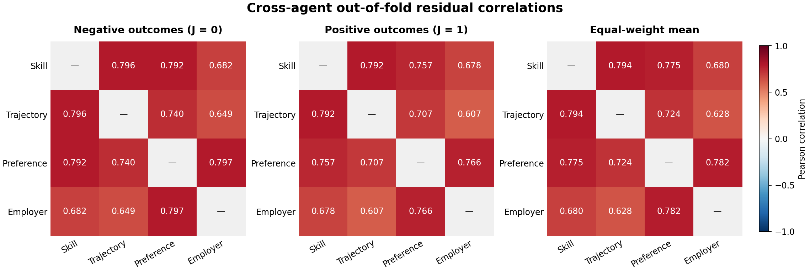

# v2 验收与结果矩阵｜面向求职者的多 Agent 岗位重排

完整方法 F 相对指定基线 B4 的联合 nDCG@5 差值为 -0.00368 [-0.01084, +0.00304]，Holm p = 1.0000。主线实耗 3.39318 单卡 GPU 小时。本次未观察到完整方法相对基线的显著提升。结论限于每人已浏览或投递的十岗池。[配对检验](../../runtime/runs/v2-phase6-20261121/eval/main/comparisons.csv) · [成本账本](../../runtime/runs/v2-phase6-20261121/eval/main/cost_ledger.csv)

## 1. 研究问题、设置、数据和结果

| 研究问题 | 实验设置 | 数据使用 | 预期检验及实测结论 |
| --- | --- | --- | --- |
| RQ1 增加专业评审 | B4 对 B1；每人 32 窗对 8 窗 | 同一测试名单与原版 8B | 估计角色与调用共同增量。联合 nDCG@5 差 +0.00222 [-0.01181, +0.01629]，区间跨零。[逐人差值](../../runtime/runs/v2-phase6-20261121/eval/main/paired_deltas.csv) |
| RQ2 共同错误降权 | T1 对 T0；T1 对 W1 为聚合器对照 | C 分析误差；T 检验排名 | 校准集显示六对正相关；降权后测试前五顺序改变 0 人。[六对相关与区间](../../runtime/runs/v2-phase5-20261121/analysis/correlated_error_pairs.csv) · [逐人差值](../../runtime/runs/v2-phase6-20261121/eval/main/paired_deltas.csv) |
| RQ3 双边效用 | F 对 T1；F 对 B4 | T 的联合、投递及已投递认可子榜 | F 与 T1 的全部十岗顺序一致，双边指标增量均为零。[逐人差值](../../runtime/runs/v2-phase6-20261121/eval/main/paired_deltas.csv) |
| Optional 逐角色蒸馏 | 32B 教师与 8B LoRA 学生 | 独立训练用户预留 256，正式使用 0 | 未运行（本次执行至 Phase 6）；F-SFT 及配对效应均为 NA。 |

## 2. 运行登记与协议验收

运行 v2-phase6-20261121，主机 hkust-gz-hpc3-temp2。标准档 Pilot / C / T 为 16 / 128 / 256。每位 T 用户固定十岗，输出前五。D 为投递，S 为已投递条件下的认可，J 为投递且获认可。[冻结设置](experimental_setting.md) · [评分前封存](../../runtime/runs/v2-phase6-20261121/evidence/preflight.json)

### 已核对的原始数据

| 项目 | 本地快照实测值 | 正式运行复核值 | 依据 |
|---|---|---|---|
| 用户 | 4,500 人，35 行补末尾空经历 | 两次构建均与快照一致 | [求职者表](../../data/AliTianChi/table1_user.txt) |
| 岗位 | 269,534 个原始岗位，隔离 1 行，269,533 个可用 | 两次构建均与快照一致 | [岗位表](../../data/AliTianChi/table2_jd.txt) |
| 行为 | 700,938 行，关联后 648,171 行，未关联 52,767 行 | 两次构建均与快照一致 | [行为表](../../data/AliTianChi/table3_action.txt) |
| 人岗对与规模 | 按人岗取最大值后 473,032 对。浏览或投递过 129,756 对。3,392 人至少有 10 岗 | 两次构建均与快照一致 | [快照哈希、状态计数与清洗口径](experimental_setting.md) |

### 执行验收

| 环节 | 验收实测 | 证据 |
| --- | --- | --- |
| 划分与固定名单 | 656 人，用户及规范化简历组跨区块重叠均为 0；T 256 人的名单与各方法的初始哈希逐一一致 | [数据验收](../../runtime/runs/v2-phase2-20261121/phase2_acceptance.md) · [名单核验](../../runtime/runs/v2-phase6-20261121/evidence/preflight.json) |
| 评审推理 | 原版 Qwen3-8B，14,336 次首轮判断，1,792 份有效选票，重试与缺失均为 0 | [运行配置](../../runtime/runs/v2-phase4-20261121/manifest.json) · [评审验收](../../runtime/runs/v2-phase4-20261121/phase4_acceptance.md) |
| 校准与配对对照 | C 内三折 43/43/42。T0/T1/W1/F 共用选票，T1/W1 有效角色和权重一致；pE 仅在已投递样本上校准。估参阶段读取 T 标签 0 次 | [可信排序验收](../../runtime/runs/v2-phase5-20261121/phase5_acceptance.md) |
| 回退与评分 | 每方法 256 份完整排名，全部计入分母核对。各方法实际回退 0。开封前合成样例雇主 nDCG 为 0.63093 | [回退清单](../../runtime/runs/v2-phase5-20261121/base/fallbacks.csv) · [评分回执](../../runtime/runs/v2-phase6-20261121/evidence/score_receipt.json) |
| 硬件与复现 | H100 单卡评审，Phase 5、6 使用 CPU。固定统计种子 20261121 | [探测验收](../../runtime/runs/v2-phase3-20261121/phase3_acceptance.md) · [独立复算](../../runtime/runs/v2-phase6-20261121/evidence/statistics_verified.json) |
| Optional 蒸馏 | 未运行（本次执行至 Phase 6） | 正式教师示范、学生训练和重评均未启动 |

## 3. 排序结果与配对比较

### 共同评价分母

| 指标 | 可评价人数 | 排除或保留情况 | 逐人依据 |
| --- | --- | --- | --- |
| 联合 nDCG@5、Recall@5 | 228 | 无联合正例 28 人 | [分母明细](../../runtime/runs/v2-phase6-20261121/eval/main/denominators.csv) |
| 投递 nDCG@5 | 250 | 无投递 6 人 | [分母明细](../../runtime/runs/v2-phase6-20261121/eval/main/denominators.csv) |
| 已投递子榜认可 nDCG@5 | 228 | 无投递 6 人，有投递但无认可 22 人 | [分母明细](../../runtime/runs/v2-phase6-20261121/eval/main/denominators.csv) |
| Top-5 联合正例数/人 | 256 | 包含 28 名候选池无联合正例用户 | [分母明细](../../runtime/runs/v2-phase6-20261121/eval/main/denominators.csv) |

### 各方法实测结果

用户等权均值及 95% 百分位区间。每个指标在所有方法间共用同一组可评价用户和 2,000 次用户重采样。雇主侧先从完整十岗筛选已投递岗位，再截前五。[冻结排名](../../runtime/runs/v2-phase5-20261121/base/rankings.jsonl)

| 方法 | 联合 nDCG@5 | 联合 Recall@5 | 投递 nDCG@5 | 已投递认可 nDCG@5 | Top-5 联合正例数/人 | 依据 |
| --- | --- | --- | --- | --- | --- | --- |
| B1 | 0.40759 [0.37253, 0.44409] | 0.52455 [0.48056, 0.56920] | 0.56291 [0.52991, 0.59644] | 0.75551 [0.72106, 0.79076] | 1.26953 [1.12891, 1.41016] | [逐人指标](../../runtime/runs/v2-phase6-20261121/eval/main/per_user.csv) |
| B4 | 0.40981 [0.37342, 0.44608] | 0.52624 [0.47989, 0.57173] | 0.57113 [0.53825, 0.60498] | 0.75614 [0.72142, 0.79077] | 1.25391 [1.11719, 1.39453] | [逐人指标](../../runtime/runs/v2-phase6-20261121/eval/main/per_user.csv) |
| T0 | 0.40613 [0.37069, 0.44137] | 0.53208 [0.48668, 0.57785] | 0.56878 [0.53551, 0.60247] | 0.75428 [0.72007, 0.78850] | 1.26172 [1.12500, 1.40234] | [逐人指标](../../runtime/runs/v2-phase6-20261121/eval/main/per_user.csv) |
| T1 | 0.40613 [0.37069, 0.44137] | 0.53208 [0.48668, 0.57785] | 0.56878 [0.53551, 0.60247] | 0.75428 [0.72007, 0.78850] | 1.26172 [1.12500, 1.40234] | [逐人指标](../../runtime/runs/v2-phase6-20261121/eval/main/per_user.csv) |
| W1 | 0.40684 [0.37117, 0.44252] | 0.52711 [0.48141, 0.57343] | 0.56633 [0.53259, 0.60076] | 0.75679 [0.72275, 0.79143] | 1.25781 [1.12109, 1.39854] | [逐人指标](../../runtime/runs/v2-phase6-20261121/eval/main/per_user.csv) |
| F | 0.40613 [0.37069, 0.44137] | 0.53208 [0.48668, 0.57785] | 0.56878 [0.53551, 0.60247] | 0.75428 [0.72007, 0.78850] | 1.26172 [1.12500, 1.40234] | [逐人指标](../../runtime/runs/v2-phase6-20261121/eval/main/per_user.csv) |
| B4-minus-skill | 0.41074 [0.37491, 0.44723] | 0.52550 [0.48002, 0.57005] | 0.57144 [0.53912, 0.60543] | 0.76137 [0.72721, 0.79514] | 1.26172 [1.12490, 1.40234] | [逐人指标](../../runtime/runs/v2-phase6-20261121/eval/main/per_user.csv) |
| B4-minus-trajectory | 0.40919 [0.37334, 0.44607] | 0.52613 [0.48139, 0.57113] | 0.57206 [0.53941, 0.60600] | 0.75290 [0.71834, 0.78690] | 1.26172 [1.12490, 1.41016] | [逐人指标](../../runtime/runs/v2-phase6-20261121/eval/main/per_user.csv) |
| B4-minus-preference | 0.40807 [0.37245, 0.44447] | 0.52602 [0.48036, 0.57147] | 0.56743 [0.53440, 0.60151] | 0.75438 [0.71980, 0.78994] | 1.25781 [1.11719, 1.40234] | [逐人指标](../../runtime/runs/v2-phase6-20261121/eval/main/per_user.csv) |
| B4-minus-employer | 0.40427 [0.36802, 0.44003] | 0.52262 [0.47715, 0.56817] | 0.56809 [0.53492, 0.60197] | 0.75062 [0.71513, 0.78566] | 1.25391 [1.11328, 1.39844] | [逐人指标](../../runtime/runs/v2-phase6-20261121/eval/main/per_user.csv) |
| Optional F-SFT | NA | NA | NA | NA | NA | 未运行 |

### 四个预登记比较

指标为联合 nDCG@5。差值按前者减后者。双侧配对符号置换 10,000 次，p 值加一修正，四项一起做 Holm 校正，显著性水平 0.05。

| 比较 | 配对用户 | 均值差 [95% CI] | 原始 p | Holm p | 依据 |
| --- | --- | --- | --- | --- | --- |
| B4−B1 | 228 | +0.00222 [-0.01181, +0.01629] | 0.76952 | 1.00000 | [逐人差值](../../runtime/runs/v2-phase6-20261121/eval/main/paired_deltas.csv) · [配对检验](../../runtime/runs/v2-phase6-20261121/eval/main/comparisons.csv) |
| T1−T0 | 228 | +0.00000 [+0.00000, +0.00000] | 1.00000 | 1.00000 | [逐人差值](../../runtime/runs/v2-phase6-20261121/eval/main/paired_deltas.csv) · [配对检验](../../runtime/runs/v2-phase6-20261121/eval/main/comparisons.csv) |
| F−T1 | 228 | +0.00000 [+0.00000, +0.00000] | 1.00000 | 1.00000 | [逐人差值](../../runtime/runs/v2-phase6-20261121/eval/main/paired_deltas.csv) · [配对检验](../../runtime/runs/v2-phase6-20261121/eval/main/comparisons.csv) |
| F−B4 | 228 | -0.00368 [-0.01084, +0.00304] | 0.30667 | 1.00000 | [逐人差值](../../runtime/runs/v2-phase6-20261121/eval/main/paired_deltas.csv) · [配对检验](../../runtime/runs/v2-phase6-20261121/eval/main/comparisons.csv) |

### 解释性比较

| 比较 | 指标 | 配对用户 | 均值差 [95% CI] | 依据 |
| --- | --- | --- | --- | --- |
| T1−W1 | 联合 nDCG@5 | 228 | -0.00070 [-0.00760, +0.00612] | [逐人差值](../../runtime/runs/v2-phase6-20261121/eval/main/paired_deltas.csv) |
| B4-minus-skill−B4 | 联合 nDCG@5 | 228 | +0.00093 [-0.00823, +0.01001] | [逐人差值](../../runtime/runs/v2-phase6-20261121/eval/main/paired_deltas.csv) |
| B4-minus-trajectory−B4 | 联合 nDCG@5 | 228 | -0.00062 [-0.00839, +0.00712] | [逐人差值](../../runtime/runs/v2-phase6-20261121/eval/main/paired_deltas.csv) |
| B4-minus-preference−B4 | 联合 nDCG@5 | 228 | -0.00173 [-0.00820, +0.00430] | [逐人差值](../../runtime/runs/v2-phase6-20261121/eval/main/paired_deltas.csv) |
| B4-minus-employer−B4 | 联合 nDCG@5 | 228 | -0.00554 [-0.01294, +0.00151] | [逐人差值](../../runtime/runs/v2-phase6-20261121/eval/main/paired_deltas.csv) |
| F−T1 | 投递 nDCG@5 | 250 | +0.00000 [+0.00000, +0.00000] | [逐人差值](../../runtime/runs/v2-phase6-20261121/eval/main/paired_deltas.csv) |
| F−T1 | 已投递认可 nDCG@5 | 228 | +0.00000 [+0.00000, +0.00000] | [逐人差值](../../runtime/runs/v2-phase6-20261121/eval/main/paired_deltas.csv) |
| Optional F-SFT−F | 联合 nDCG@5 | NA | NA | 未运行 |

## 4. 角色贡献与跨 Agent 相关错误

温度来自完整 C；Brier 和残差相关来自 C 的样本外预测。移除效应按测试集上的“移除该角色后 B4 − 完整 B4”计算。

| 角色 | 共同头温度 | C 人数 | Brier | T0 权重 | T1 权重 | 变化（百分点） | 移除效应 [95% CI] | 依据 |
| --- | --- | --- | --- | --- | --- | --- | --- | --- |
| Skill | 0.72999 | 128 | 0.21354 | 26.016% | 25.546% | -0.470 | +0.00093 [-0.00823, +0.01001] | [权重明细](../../runtime/runs/v2-phase5-20261121/analysis/role_weights.csv) · [逐人差值](../../runtime/runs/v2-phase6-20261121/eval/main/paired_deltas.csv) |
| Trajectory | 0.86703 | 128 | 0.20222 | 27.222% | 27.602% | +0.380 | -0.00062 [-0.00839, +0.00712] | [权重明细](../../runtime/runs/v2-phase5-20261121/analysis/role_weights.csv) · [逐人差值](../../runtime/runs/v2-phase6-20261121/eval/main/paired_deltas.csv) |
| Preference | 0.91582 | 128 | 0.23525 | 23.852% | 23.199% | -0.653 | -0.00173 [-0.00820, +0.00430] | [权重明细](../../runtime/runs/v2-phase5-20261121/analysis/role_weights.csv) · [逐人差值](../../runtime/runs/v2-phase6-20261121/eval/main/paired_deltas.csv) |
| Employer | 1.17593 | 128 | 0.24533 | 22.909% | 23.653% | +0.743 | -0.00554 [-0.01294, +0.00151] | [权重明细](../../runtime/runs/v2-phase5-20261121/analysis/role_weights.csv) · [逐人差值](../../runtime/runs/v2-phase6-20261121/eval/main/paired_deltas.csv) |

各对按同人同岗对齐，残差为校准共同概率减 J。负例层反映高估程度的同步性，正例层反映低估程度的同步性。区间沿用 Phase 5 在原折内按人 bootstrap 并重拟合温度 2,000 次的结果。

| 角色对 | J=0 人/岗 | ρ₀ [95% CI] | J=1 人/岗 | ρ₁ [95% CI] | 两类等权 ρ [95% CI] | 原样本退化原因（0/1 层） | 重采样退化次数（0/1 层） | 依据 |
| --- | --- | --- | --- | --- | --- | --- | --- | --- |
| Skill × Trajectory | 128/986 | 0.7962 [0.7625, 0.8284] | 112/294 | 0.7921 [0.7236, 0.8488] | 0.7942 [0.7535, 0.8287] | 无 / 无 | 0 / 0 | [六对相关与区间](../../runtime/runs/v2-phase5-20261121/analysis/correlated_error_pairs.csv) |
| Skill × Preference | 128/986 | 0.7921 [0.7576, 0.8205] | 112/294 | 0.7569 [0.6888, 0.8108] | 0.7745 [0.7337, 0.8074] | 无 / 无 | 0 / 0 | [六对相关与区间](../../runtime/runs/v2-phase5-20261121/analysis/correlated_error_pairs.csv) |
| Skill × Employer | 128/986 | 0.6824 [0.6200, 0.7163] | 112/294 | 0.6777 [0.5716, 0.7530] | 0.6800 [0.6065, 0.7206] | 无 / 无 | 0 / 0 | [六对相关与区间](../../runtime/runs/v2-phase5-20261121/analysis/correlated_error_pairs.csv) |
| Trajectory × Preference | 128/986 | 0.7405 [0.7013, 0.7723] | 112/294 | 0.7071 [0.6270, 0.7682] | 0.7238 [0.6766, 0.7593] | 无 / 无 | 0 / 0 | [六对相关与区间](../../runtime/runs/v2-phase5-20261121/analysis/correlated_error_pairs.csv) |
| Trajectory × Employer | 128/986 | 0.6492 [0.5704, 0.6906] | 112/294 | 0.6072 [0.4965, 0.6864] | 0.6282 [0.5515, 0.6756] | 无 / 无 | 0 / 0 | [六对相关与区间](../../runtime/runs/v2-phase5-20261121/analysis/correlated_error_pairs.csv) |
| Preference × Employer | 128/986 | 0.7969 [0.7445, 0.8265] | 112/294 | 0.7663 [0.6721, 0.8310] | 0.7816 [0.7164, 0.8221] | 无 / 无 | 0 / 0 | [六对相关与区间](../../runtime/runs/v2-phase5-20261121/analysis/correlated_error_pairs.csv) |

Skill 与 Trajectory 的等权相关最高（0.794）。Preference 权重降幅最大（−0.653 个百分点），Employer 升幅最大（+0.743 个百分点）。T1 对 T0 仅 1 人的后五名顺序有变化，全部 256 人的前五顺序一致。这支持校准集存在冗余，降权在本次测试上未带来联合 nDCG@5 增量。[逐榜核对](../../runtime/runs/v2-phase6-20261121/evidence/statistics_verified.json) · [Phase 5 分析](../../runtime/runs/v2-phase5-20261121/analysis/correlated_error_report.md)

投递概率温度为 11.06387（C 上 1280 岗）。条件认可概率温度为 20.00000（657 个已投递人岗对），达到冻结上界。F 与 T1 在所有测试用户上的完整排序一致，投递侧和雇主侧的变化均为零。[正式校准参数](../../runtime/runs/v2-phase5-20261121/base/calibration.json) · [逐人差值](../../runtime/runs/v2-phase6-20261121/eval/main/paired_deltas.csv)

## 5. 硬件、成本、失败记录与 Optional 状态

按[第 3 期硬件探测协议](phase3_pilot_budget.md)登记 8B 推理、32B-AWQ 生成、8B 全参数更新与 LoRA 更新的配置、实测吞吐和峰值显存。下表用于排期，正式运行的实耗另记。单张 H100 已完成 32B 教师推理、8B 全参数与 LoRA 更新及学生重评。以下范围按 pilot 的最快、最慢观测速率外推。

| 独立路线 | 硬件可行性 | 预计墙钟小时及范围 | 预计 GPU 小时及范围 | 工作量、速率与证据路径 |
|---|---|---:|---:|---|
| 主 pipeline | 8B 可用，BF16，batch=2 | 5.02 [4.31, 6.43] | 5.02 [4.31, 6.43] | 14,336 窗。[8B 原始计时](../../runtime/runs/v2-phase3-20261121/pilot/base.jsonl) · [路线外推](../../runtime/runs/v2-phase3-20261121/pilot/runtime_estimates.csv) |
| 主 pipeline + SFT（全参数） | 8 步通过，训练分配峰值 63.43 GiB | 11.48 [9.53, 13.49] | 11.48 [9.53, 13.49] | 教师 2,048 窗、预计 256 步、学生重评 12,288 窗。[全参日志](../../runtime/runs/v2-phase3-20261121/pilot/full.jsonl) |
| 主 pipeline + SFT + LoRA（适配器 SFT） | 8 步通过，训练分配峰值 20.64 GiB | 13.53 [11.45, 15.70] | 13.53 [11.45, 15.70] | 同一教师工作量、预计 256 步、学生重评 12,288 窗。[LoRA 日志](../../runtime/runs/v2-phase3-20261121/pilot/lora.jsonl) |

教师首批 32 窗保留 4 条，据此外推训练规模。补测 48 窗，取得 9 条中等长度示范供硬件训练探测。全参数训练出现显存分配告警，8 步均完成。墙钟和 GPU 小时保留两位后相同，估算 CSV 分别保留五位。[第 3 期验收、参数、估算假设与范围](../../runtime/runs/v2-phase3-20261121/phase3_acceptance.md)

| 阶段 | 首轮窗 | 重试 | 单卡小时 | CPU 墙钟秒 | 计时口径 | 依据 |
| --- | --- | --- | --- | --- | --- | --- |
| Phase 1 | 不适用 | 不适用 | 1.19087 | — | 开发实例占用上界估记，平台计费未核实 | [成本账本](../../runtime/runs/v2-phase6-20261121/eval/main/cost_ledger.csv) · [来源](../../runtime/runs/v2-phase1-20261121/gpu_hours.csv) |
| Phase 3 | 184 | 0 | 0.21980 | — | 独立探测作业（含中断），不计入主线 | [成本账本](../../runtime/runs/v2-phase6-20261121/eval/main/cost_ledger.csv) · [来源](../../runtime/runs/v2-phase3-20261121/gpu_hours.csv) |
| C_four | 4096 | 0 | 1.00647 | — | 批次生成耗时 | [成本账本](../../runtime/runs/v2-phase6-20261121/eval/main/cost_ledger.csv) · [来源](../../runtime/runs/v2-phase4-20261121/acceptance.json) |
| T_four | 8192 | 0 | 1.92313 | — | 批次生成耗时 | [成本账本](../../runtime/runs/v2-phase6-20261121/eval/main/cost_ledger.csv) · [来源](../../runtime/runs/v2-phase4-20261121/acceptance.json) |
| T_B1 | 2048 | 0 | 0.38711 | — | 批次生成耗时 | [成本账本](../../runtime/runs/v2-phase6-20261121/eval/main/cost_ledger.csv) · [来源](../../runtime/runs/v2-phase4-20261121/acceptance.json) |
| Phase 4 其他占卡 | 不适用 | 不适用 | 0.07647 | — | 作业占卡总量减批次生成；含装载、准备、写盘及退出 | [成本账本](../../runtime/runs/v2-phase6-20261121/eval/main/cost_ledger.csv) · [来源](../../runtime/runs/v2-phase4-20261121/gpu_hours.csv) |
| Phase 5 | 0 | 0 | 0.00000 | 18.891 | 正式、补充和验收三项 CPU 作业墙钟之和 | [成本账本](../../runtime/runs/v2-phase6-20261121/eval/main/cost_ledger.csv) · [来源](../../runtime/runs/v2-phase5-20261121/evidence/run_receipt.json) |
| Phase 6 | 0 | 0 | 0.00000 | 0.812 | 评分和独立统计复算；文档整理与 SSH 等待另计 | [成本账本](../../runtime/runs/v2-phase6-20261121/eval/main/cost_ledger.csv) · [来源](../../runtime/runs/v2-phase6-20261121/evidence/statistics_verified.json) |

主线共 14,336 次判断、0 次重试。在 H100 上实耗 3.39318 小时，较 pilot 外推 5.01879 小时减少 1.62561 小时（32.39%）。批次生成合计 3.31671 小时，其余 0.07647 小时包括装载、准备与落盘，记录支持合并计量。CPU 评分耗时 0.557 秒，独立统计复算 0.255 秒，均为零 GPU 小时。[成本账本](../../runtime/runs/v2-phase6-20261121/eval/main/cost_ledger.csv)

主线加 pilot 的实测占卡共 3.61298 小时。另计 Phase 1 开发实例准备时段的保守估计 1.19087 小时后为 4.80384 小时，平台账单未核实。[成本汇总](../../runtime/runs/v2-phase6-20261121/eval/main/cost_summary.json)

评审首轮失败、重试后持久失败、缺失角色均为 0。六种主方法与四个角色移除对照逐方法回退均为 0，F 沿用 BM25 与缺双边头退回 T1 分别为 0。[评审统计](../../runtime/runs/v2-phase4-20261121/acceptance.json) · [逐方法复核](../../runtime/runs/v2-phase6-20261121/evidence/statistics_verified.json)

**Optional 蒸馏状态：未运行（本次执行至 Phase 6）。** 正式教师生成、学生 LoRA 训练和重评的新增 GPU 小时均为 0。四个教师角色尝试及保留示范均为 0；保留率、学生效果和学生回退为 NA。Phase 3 的教师探测样本计入 pilot。
