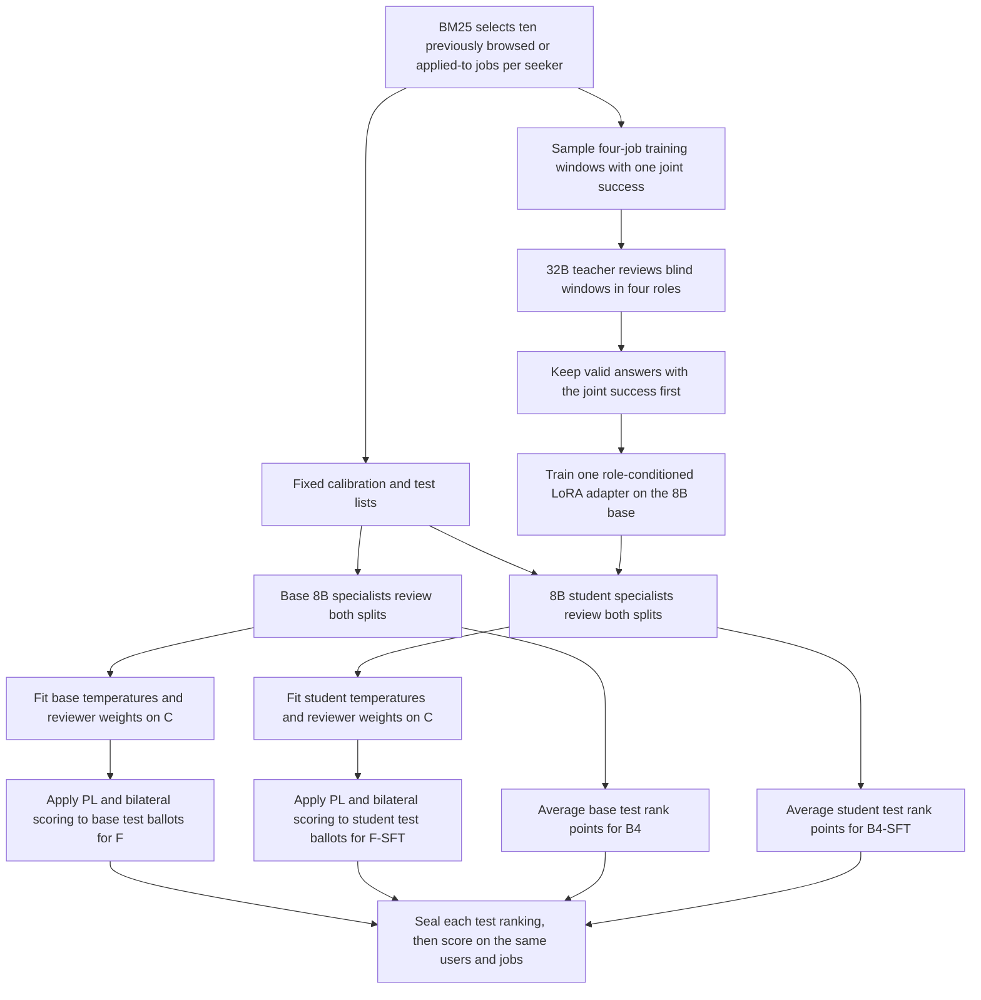

# Method and pipeline

Each run produces an ordering of ten jobs and recommends the first five. Calibration set C supplies the parameters for its own model. Test set T supplies the person–job outcomes for evaluation. The base run also produces the generalist, simple aggregation and component controls used in RQ1–3. [Research questions](README.md#research-questions) · [Evaluation protocol and results](metric_result.md)

## Candidate lists and observed outcomes

Let $u$ denote a job seeker and $j$ a job. After an inner join on the person and job identifiers, take the maximum of each binary behavior flag across duplicate records for $(u,j)$. Each flag thus describes an event that occurred at least once in the recorded history. The candidate pool $H_u$ contains jobs with a browse or an application. The labels used within that pool are

$$
D_{uj}=\mathbf{1}\{\text{application recorded}\},\qquad
S_{uj}=\text{recorded employer approval, observed when }D_{uj}=1,
$$

$$
J_{uj}=
\begin{cases}
S_{uj}, & D_{uj}=1,\\
0, & D_{uj}=0.
\end{cases}
$$

Here $J$ denotes an application **and** approval, often written $D\times S$. The second line fixes the joint outcome even though employer approval for an unapplied job is unknown. Training window selection and final evaluation use this same joint label. [Data construction](../code/phase2_data_prep.py) · [Data acceptance](../runtime/runs/v2-phase2-20261121/phase2_acceptance.md)

RecPO models both preference intensity and how recently an interaction occurred when predicting the next item in a sequence. Here, taking the maximum application flag collapses different histories to the same $D=1$. A recent application and an older one receive equal weight, and the flag records only that the seeker applied. [Ouyang et al. (2026)][recpo]

**Building the ten-job list.** The query uses current industry, job type, education, experience, desired industry and desired job type. The document uses the job title, subtype, keywords, minimum education and job description. Normalize text with NFKC, lowercase it and collapse whitespace. Tokenize consecutive Han characters into overlapping bigrams and lowercase Latin-letter sequences into words. The query contributes each distinct token once. The implemented BM25 variant scores job $j$ for query-token set $Q_u$ as

$$
\begin{aligned}
\operatorname{idf}(t)&=\ln\left(1+\frac{N-n_t+0.5}{n_t+0.5}\right),\\
\operatorname{BM25}(u,j)&=
\sum_{t\in Q_u}\operatorname{idf}(t)
\frac{f_{tj}(k_1+1)}
{f_{tj}+k_1(1-b+b\,L_j/\bar L)} .
\end{aligned}
$$

Here $f_{tj}$ is the term frequency in the job, $L_j$ its token length, and $n_t$ the number of valid job documents containing the term. Document frequencies and mean length $\bar L=238.7050$ use **all 269,533 valid postings**. Set $k_1=1.2$ and $b=0.75$. Sort jobs **within $H_u$** by score descending and then by job ID ascending, and take the first ten. Denote their ordered list by $L_u^0$. Eligibility uses $|H_u|\ge10$. Employer approval is hidden during list construction. [Robertson and Zaragoza (2009)][bm25] · [Implementation](../code/phase2_data_prep.py) · [Corpus audit](../runtime/runs/v2-phase2-20261121/data/audit.json)

**Splitting by person.** Sort eligible users by the seeded hash of the user ID, then keep the first representative of each normalized résumé group. A group is defined by current industry, job type, salary, degree, work start date and experience. With seed 20261121 the standard split assigns 16 representatives to pilot, 128 to C, 256 to T and 256 to training. All methods use the same per-person list and starting order. The review prompts carry profile and job features plus temporary within-window indices. The original identifiers and observed behavior remain in the data and scoring records. [Split and prompt-field checks](../runtime/runs/v2-phase2-20261121/phase2_acceptance.md)

## Multi-agent review and sliding windows

An **agent** is one role-conditioned reviewer. ChatEval assigns distinct personas to text evaluators and lets them discuss the text before judging its quality. In RQ1 each specialist instead uses its own prompt and copy of $L_u^0$, updates that list independently, and submits a complete ballot for aggregation. The reviewers share model weights and source records, so independent execution still allows correlated judgments. [Chan et al. (2024)][chateval] · [Base model card][qwen8] · [Formal review configuration](../runtime/runs/v2-phase4-20261121/manifest.json)

| Reviewer | Evidence emphasized by its instruction | Required output for each four-job window |
|---|---|---|
| Skill | Evidence of skills relevant to the jobs | One permutation and four joint probabilities $p^J$ |
| Trajectory | Work history and the transition from previous jobs to the proposed role | Same permutation format and $p^J$ |
| Preference | Explicit job-seeking intentions | Permutation, $p^J$ and application probabilities $p^C$ |
| Employer | Job requirements and entry criteria | Permutation, $p^J$ and approval probabilities $p^E$ conditional on application |
| Generalist (B1) | Skills, history, intentions and requirements in a single instruction | Permutation and $p^J$ |

Yuksel et al. generate job-specific rubrics to assess candidates against explicit hiring criteria. The four specialist prompts above also direct attention to particular evidence, but the criteria here stay fixed as each reviewer ranks jobs for a seeker. [Yuksel et al. (2026)][agentic-hr]

All reviewers rank by the *same* event $J$. Throughout a fixed list, $p^C$ estimates $P(D=1\mid\text{profile, job})$ and $p^E$ estimates $P(S=1\mid D=1,\text{profile, job})$. The three probability outputs are numeric judgments generated as part of the reply. The generalist is a separate test control. [Role prompts](../runtime/runs/v2-phase4-20261121/code/phase3_probe.py)

In an observational study of 736 résumés, GPT-4 ratings correlated only weakly with human ratings of candidate qualifications. Here the Employer role predicts a different observable outcome. We calibrate its $p^E$ against the Tianchi approval flag $S$ among jobs the seeker applied to. [Vaishampayan et al. (2025)][human-matching]

**Window update.** For each role, visit positions **7–10 → 5–8 → 3–6 → 1–4** in the *current* list. For example, if the first window contains jobs $g,h,i,j$ and the model returns $[3,1,4,2]$, write $i,g,j,h$ back into positions 7–10. The second window now includes $i,g$ at positions 7 and 8. After the first pass reaches the head, start a second pass at the tail of the updated list. Each role makes eight judgments and returns its final ten-job ordering as its ballot. ConFit v3 applies bottom-up windows to 20 résumés for a job. We adapt its multipass procedure to ten jobs for one seeker. [Yu et al. (2026), Appendix G][confit] · [Window update code](../code/review_windows.py)

Use greedy decoding with thinking disabled and a batch size of two. The input limits are 512 tokens for the profile, 640 per job and 3,840 for the whole prompt. Structured fields precede free text, with each field block truncated to its token prefix. At most 256 output tokens are generated. The return format requires a permutation of indices 1–4 and a finite probability in $[0,1]$ for every required head and job. Probability arrays follow the **input indices** so each number can be assigned to the correct job even as the ranking changes. [Inference manifest](../runtime/runs/v2-phase4-20261121/manifest.json) · [Parser and replay](../code/review_windows.py)

**Combining repeated observations.** For user $u$, role $a$, job $j$ and probability head $h$, let $\mathcal V_{aujh}$ contain the windows in which that job received the head. With $\sigma(z)=1/(1+e^{-z})$ and $\operatorname{logit}(p)=\ln[p/(1-p)]$, the job-level estimate is

$$
\bar p^h_{auj}=\sigma\left(
\frac{1}{|\mathcal V_{aujh}|}\sum_{v\in\mathcal V_{aujh}}
\operatorname{logit}\bigl(\operatorname{clip}(p^h_{aujv},10^{-4},1-10^{-4})\bigr)
\right).
$$

The returned permutations determine the ballot. The pooled probabilities contribute one observation per role and person–job pair to calibration, regardless of how many windows contained the job. [Ballot and probability reconstruction](../code/review_windows.py)

## Calibration, reliability and shared errors

**Temperature scaling.** Assign C users in their fixed split order to three folds round-robin (43, 43 and 42 people). Keep a person's ten jobs in one fold. For a given head, let $I$ contain its eligible observations from the two fitting folds, with raw pooled logit $x_i$ and binary target $y_i$. Fit a temperature $\tau$ by minimizing binary negative log likelihood, then apply it to the held-out fold.

$$
q_i(\tau)=\sigma(x_i/\tau),\qquad
\widehat{\tau}=\arg\min_{\tau\in[0.05,20]}
-\frac{1}{|I|}\sum_{i\in I}
\bigl[y_i\ln q_i(\tau)+(1-y_i)\ln(1-q_i(\tau))\bigr].
$$

Targets are $J$ for the four common heads, $D$ for the Preference application head, and $S$ restricted to $D=1$ for the Employer approval head. Rotating the held-out fold yields an out-of-fold prediction for each eligible observation. A single-class target or all-zero logits uses $\tau=1$. A head with no fitting observations is unavailable. Fit each head again on full C for use on T. [Guo et al. (2017)][temperature] · [Temperature fits](../runtime/runs/v2-phase5-20261121/code/phase5_calibration.py)

**Reliability.** Let $\hat p^J_{auj}$ be the out-of-fold calibrated joint prediction, and $C_a$ the C users with a complete ballot and ten valid predictions for role $a$. First average squared probability error within a user, then weight users equally. Smaller binary Brier error gives greater reliability.

$$
e_{auj}=\hat p^J_{auj}-J_{uj},\qquad
BS_a=\frac{1}{|C_a|}\sum_{u\in C_a}\frac{1}{10}\sum_{j\in L_u^0} e_{auj}^2,
\qquad r_a=\exp(-BS_a/0.25).
$$

**Shared errors.** Kim et al. studied dependence across models in benchmarking and résumé screening. On multiple-choice questions, they measured how often two models chose the same wrong answer given that both erred. Our four roles share one 8B model and report probabilities for the same person–job pairs. We therefore measure how their probability residuals vary together within joint failures and within joint successes. [Kim et al. (2025)][correlated-errors]

For roles $a,b$ and class $y$, take aligned pairs $I_{ab,y}=\{(u,j):J_{uj}=y\}$ with both residuals present. Let $\bar e_{a,y}$ and $\bar e_{b,y}$ be their means on this same set. Compute the within-class Pearson correlation and average the two classes equally.

$$
\rho_{ab,y}=
\frac{\sum_{i\in I_{ab,y}}(e_{ai}-\bar e_{a,y})(e_{bi}-\bar e_{b,y})}
{\sqrt{\sum_{i\in I_{ab,y}}(e_{ai}-\bar e_{a,y})^2
       \sum_{i\in I_{ab,y}}(e_{bi}-\bar e_{b,y})^2}},
\qquad \rho_{ab}=\frac{\rho_{ab,0}+\rho_{ab,1}}{2}.
$$

Stratification removes variation due solely to switching the shared outcome label between zero and one. A positive coefficient on negatives indicates that the roles tend to overestimate the same jobs to similar degrees. On positives it indicates shared variation in underestimation. A stratum with fewer than two pairs or constant residuals contributes zero and is flagged. For the base analysis, 2,000 bootstrap replicates resampled people *within their original folds*, keeping all ten jobs and four common heads together. Each replicate refit the fold temperatures and recomputed the three coefficients. Their 2.5th and 97.5th percentiles quantify uncertainty. The ranking uses the original estimates. [Correlation estimator and resampling](../runtime/runs/v2-phase5-20261121/code/phase5_supplement.py) · [Correlation results](metric_result.md#correlated-errors-and-reviewer-weights)

## Aggregating the ballots

Write $\pi_a$ for a complete ballot, $\operatorname{rank}_a(j)=1$ for its first job and $s_a(j)=(10-\operatorname{rank}_a(j))/9$ for its rank points. B1 uses the generalist's ballot directly. B4 averages $s_a(j)$ across the set $A_u$ of valid specialists. A leave-one-role-out B4 uses the same rule after dropping that role and recomputing the equal weights.

$$
s_{\mathrm{B4}}(j)=\frac{1}{|A_u|}\sum_{a\in A_u}s_a(j).
$$

For trusted aggregation, retain roles with a complete ballot and an estimated reliability. The correlation penalty $d_a$ is computed once from C across all specialist pairs. Normalize the corresponding weights over the roles usable for that user, denoted $A_u^*$.

On three natural language inference datasets, Kohli estimated that a panel of nine judges supplied about two independent votes’ worth of information. For our four reviewers, RQ2 measures dependence on C using six pairwise residual correlations. We then track how the penalty changes the normalized weights and use T1−T0 on T to test whether those changes improve ranking. [Kohli (2026)][nine-judges]

$$
d_a=1+\sum_{b\ne a}\max(0,\rho_{ab}),\qquad
w_a^{(0)}=\frac{r_a}{\sum_{b\in A_u^*}r_b},\qquad
w_a^{(1)}=\frac{r_a/d_a}{\sum_{b\in A_u^*}r_b/d_b}.
$$

T0 uses $w^{(0)}$ and T1 uses $w^{(1)}$. For each user's ten jobs fit scores $\theta_j$ to the full ballots with the weighted Plackett–Luce (PL) objective. At position $k$ the choices are the jobs still available in that ballot. Its last position contributes zero log likelihood.

$$
\hat{\boldsymbol{\theta}}=\arg\max_{\boldsymbol{\theta}\in\mathbb R^{10}}
\left\{\sum_{a\in A_u^*} w_a\sum_{k=1}^{9}
\left[\theta_{\pi_a(k)}-
\ln\left(\sum_{\ell=k}^{10}e^{\theta_{\pi_a(\ell)}}\right)\right]
-0.1\sum_{j\in L_u^0}\theta_j^2\right\}.
$$

Rank jobs by fitted $\hat\theta_j$ descending. W1 uses the identical roles and $w^{(1)}$ from T1 to rank by $s_{\mathrm{W1}}(j)=\sum_{a\in A_u^*}w_a^{(1)}s_a(j)$. This comparison holds the inputs and weights fixed while changing the aggregation rule. The PL likelihood comes from the ranking model. The Brier scale, positive-correlation penalty and regularization coefficient are project settings. [Plackett (1975)][pl] · [Implemented objectives](../runtime/runs/v2-phase5-20261121/code/phase5_ranking.py)

Yuksel et al. fit PL to local orderings of actively selected candidate subsets for a job. Here the observations entering PL are the specialists’ complete ten-job ballots for one seeker after fixed sliding-window passes. Each ballot carries its role’s weight learned on C. [Yuksel et al. (2026)][agentic-hr]

**Bilateral reranking.** Normalize the T1 rank to $R_u(j)$, taking values from 1 for the first job to 0 for the last. Use the full-C temperatures to calibrate the two side probabilities on T, denoted $q^C_{uj}$ and $q^E_{uj}$. The project fixes the following recommendation score.

$$
R_u(j)=\frac{10-\operatorname{rank}_{\mathrm{T1}}(j)}9,\qquad
G_u(j)=\sqrt{q^C_{uj}\,q^E_{uj}},\qquad
F_u(j)=0.5 R_u(j)+0.5 G_u(j).
$$

Sort by $F_u(j)$ descending and take the top five. $F$ is a ranking score. The geometric mean rewards jobs with support from both sides. For two adjacent T1 ranks the rank-score gap is $1/9$, so the lower-ranked job needs a bilateral-score advantage greater than $1/9$ to strictly overtake its neighbor. All score ties use ascending job ID. [Bilateral implementation](../runtime/runs/v2-phase5-20261121/code/phase5_ranking.py)

**Failure rules.** A failed window receives one retry. If it still fails, discard that role's ballot for the person and skip its remaining windows. B1 falls back to BM25 if its generalist ballot is missing. A multi-role score with fewer than two usable ballots falls back to BM25, as does a failed PL fit. F inherits a T1 fallback. If the trusted order exists but any job lacks a calibrated side probability, the whole list reverts to T1. All fallbacks count in evaluation. [Window replay](../code/review_windows.py) · [Ranking fallbacks](../runtime/runs/v2-phase5-20261121/code/phase5_ranking.py)

## Teacher demonstrations and student training

**Collecting demonstrations.** For each reserved training user, enumerate four-job subsets $V\subset L_u^0$ satisfying $\sum_{j\in V}J_{uj}=1$. With seed 20261121, sample up to two distinct eligible subsets without replacement and shuffle each subset's order. All four teacher roles receive the same ordering and blind job text. Each answers independently. Filtering uses training labels after generation. If $\pi_{a,V}(1)$ is the first job returned by role $a$, the acceptance rule is

$$
\operatorname{keep}(a,V)=
\mathbf 1\{\text{valid permutation and required probability fields}\}
\cdot \mathbf 1\{J_{u,\pi_{a,V}(1)}=1\}.
$$

A valid answer with the wrong first job is filtered immediately. The rule checks the positive job's position and output format. The other three ranks and numeric probabilities are teacher-provided targets. The retained training example pairs the exact role prompt and blind input with the teacher's answer text. ConFit v3 used Claude Sonnet 4.5 for its demonstration study and omitted SFT in its AliTianChi main experiment. We adapt the top-positive filter and train on four-role answers from **Qwen3-32B-AWQ**. [Yu et al. (2026), §3.5 and Table 6][confit] · [Teacher model card][qwen32] · [Window sampler](../runtime/runs/v2-phase7-20261121/code/prepare.py) · [Filter](../runtime/runs/v2-phase7-20261121/code/filter.py)

**Training the shared 8B student.** Keep the base weights $W_0$ frozen. Each targeted linear transformation has a trainable low-rank update $\Delta W=(\alpha/r)BA$, where $A$ maps into a rank-$r$ space and $B$ maps back to the output dimension. The PEFT setting was `all-linear`, $r=16$, $\alpha=32$, dropout 0, with BF16 base weights and FP32 adapter parameters. The same adapter serves every role. [Hu et al. (2021)][lora] · [Student configuration](../runtime/runs/v2-phase8-20261121/distill/config.json)

For demonstration $i$, let $x_i$ include the full role prompt and blind input, and let $y_i$ be the tokenized teacher answer followed by the end-of-sequence token. The prompt tokens condition generation. Only answer tokens and EOS enter the causal-language-model loss,

$$
\ell_i=-\frac{1}{|y_i|}\sum_{t=1}^{|y_i|}
\ln P_{W_0+\Delta W}(y_{it}\mid x_i,y_{i,<t}).
$$

Shuffle all 505 examples once with seed 20261121. Train one epoch with AdamW at fixed learning rate $10^{-4}$, microbatch one and gradient accumulation one, for 505 updates. Use the final adapter and reload it into a fresh inference process. The 8B and 32B snapshot revisions are `b968826d9c46dd6066d109eabc6255188de91218` and `0499c3ac83fdef8810b907a23894ba91e95eddd8`, respectively. [Training code](../runtime/runs/v2-phase8-20261121/code/train.py) · [Reload receipt](../runtime/runs/v2-phase8-20261121/evidence/reload.json) · [Teacher manifest](../runtime/runs/v2-phase7-20261121/distill/teacher_manifest.json)

**Same-list evaluation.** Rerun the four student roles on the original C and T lists with the same prompts, decoding and window order. B1 reuses the original generalist cache. The student produces different probability values and ballots, so fit its six temperatures, four reliabilities, six correlations and role weights on its own C outputs using the original folds. Apply the same PL and bilateral formulas on T. Seal all 256 F-SFT orders before the student scorer reads T labels. The frozen Phase 8 contrast is the paired change in joint nDCG@5 against frozen F. The evaluation unit is the seeker. [Student ranking seal](../runtime/runs/v2-phase8-20261121/evidence/blind_seal.json) · [Scoring receipt](../runtime/runs/v2-phase8-20261121/evidence/score_receipt.json) · [Metric formulas and comparisons](metric_result.md)

**Post hoc equal-weight ablation.** Phase 9 first replayed B4 from the base test ballots and matched all 256 frozen orders. It then applied the same rule to the 1,024 valid specialist ballots already produced by the Phase 8 student on T. Each job receives the mean of $(10-r)/9$ across valid ballots, where $r$ is its one-based rank on a ballot. Ties go to the smaller job ID. With fewer than two valid ballots, the rule returns the original BM25 order. All 256 student lists had four valid ballots. The ranking process sealed B4-SFT before a separate scorer opened the test labels and paired each seeker with the original B4 result. [Ranking seal](../runtime/runs/v2-phase9-20261123/ranking_seal.json) · [Phase 9 acceptance](../runtime/runs/v2-phase9-20261123/phase9_acceptance.md)

## References

1. Stephen Robertson and Hugo Zaragoza (2009). *The Probabilistic Relevance Framework: BM25 and Beyond*. Foundations and Trends in Information Retrieval. [Paper][bm25]
2. Xiao Yu et al. (2026). *ConFit v3: Improving Resume-Job Matching with LLM-based Re-Ranking*. The demonstration study is in §3.5, the AliTianChi result in Table 6 and the window algorithm in Appendix G. [Paper][confit]
3. Qwen Team. *Qwen3-8B* and *Qwen3-32B-AWQ*. Official model cards for the base/student and the quantized teacher. [8B model card][qwen8] · [32B-AWQ model card][qwen32]
4. Chuan Guo, Geoff Pleiss, Yu Sun and Kilian Q. Weinberger (2017). *On Calibration of Modern Neural Networks*. ICML. [Paper][temperature]
5. R. L. Plackett (1975). *The Analysis of Permutations*. Applied Statistics 24(2), 193–202. [Paper][pl]
6. Edward J. Hu et al. (2021). *LoRA: Low-Rank Adaptation of Large Language Models*. [Paper][lora]
7. Kamer Ali Yuksel, Abdul Basit Anees, Ashraf Hatim Elneima, Sanjika Hewavitharana, Mohamed Al-Badrashiny and Hassan Sawaf (2026). *Agentic AI for Human Resources: LLM-Driven Candidate Assessment*. EACL System Demonstrations. [Paper][agentic-hr]
8. Elliot Kim, Avi Garg, Kenny Peng and Nikhil Garg (2025). *Correlated Errors in Large Language Models*. ICML. [Paper][correlated-errors]
9. Zhongyu Ouyang, Qianlong Wen, Chunhui Zhang, Yanfang Ye and Soroush Vosoughi (2026). *What Makes LLMs Effective Sequential Recommenders? A Study on Preference Intensity and Temporal Context*. ACL. [Paper][recpo]
10. Swanand Vaishampayan, Hunter Leary, Yoseph Berhanu Alebachew, Louis Hickman, Brent Stevenor, Weston Beck and Chris Brown (2025). *Human and LLM-Based Resume Matching: An Observational Study*. Findings of NAACL. [Paper][human-matching]
11. Chi-Min Chan, Weize Chen, Yusheng Su, Jianxuan Yu, Wei Xue, Shanghang Zhang, Jie Fu and Zhiyuan Liu (2024). *ChatEval: Towards Better LLM-Based Evaluators through Multi-Agent Debate*. ICLR. [Paper][chateval]
12. Guneet Kohli (2026). *Nine Judges, Two Effective Votes: Correlated Errors Undermine LLM Evaluation Panels*. arXiv:2605.29800. [Paper][nine-judges]

[bm25]: https://doi.org/10.1561/1500000019
[confit]: https://arxiv.org/html/2605.09760v1
[qwen8]: https://huggingface.co/Qwen/Qwen3-8B
[qwen32]: https://huggingface.co/Qwen/Qwen3-32B-AWQ
[temperature]: https://proceedings.mlr.press/v70/guo17a.html
[pl]: https://doi.org/10.2307/2346567
[lora]: https://arxiv.org/abs/2106.09685
[agentic-hr]: https://aclanthology.org/2026.eacl-demo.24/
[correlated-errors]: https://arxiv.org/pdf/2506.07962
[recpo]: https://aclanthology.org/2026.acl-long.656/
[human-matching]: https://aclanthology.org/2025.findings-naacl.270/
[chateval]: https://proceedings.iclr.cc/paper_files/paper/2024/file/25cc3adf8c85f7c70989cb8a97a691a7-Paper-Conference.pdf
[nine-judges]: https://arxiv.org/abs/2605.29800
