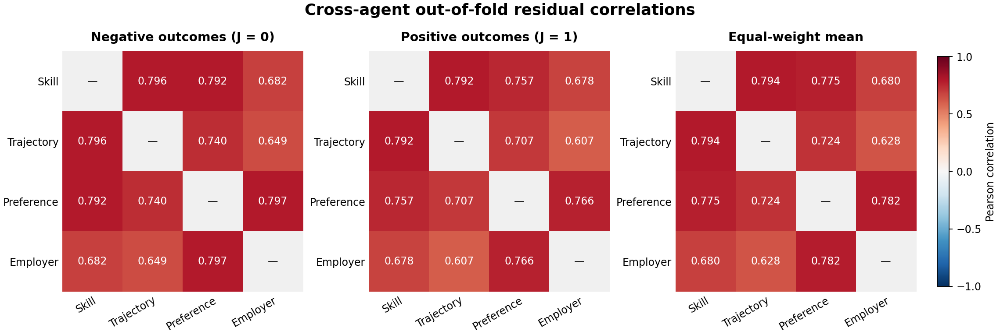

# Metrics and results

The primary endpoint is joint nDCG@5 on previously browsed or applied-to jobs. The four questions also require knowing which people contribute to a metric, which rankings actually change and whether the two sides benefit equally. This page gives the definitions, all ten base-model configurations and the distilled student's results. [Main report](README.md) · [Method and pipeline](method_pipeline.md)

## Five ranking metrics

For seeker $u$, let $\pi_u$ order the ten fixed jobs. Write $D$ for application, $S$ for the employer's observed approval after application, and $J$ for application **and** approval. An unapplied job carries $J=0$ and an unobserved $S$. For an ordered binary label sequence $y=(y_1,\ldots,y_n)$, write $P(y)=\sum_i y_i$ and $K=5$. The position discount and its ideal ordering on this very list are

$$
\operatorname{DCG}@K(y)=\sum_{i=1}^{\min(K,n)}\frac{y_i}{\log_2(i+1)},\qquad
\operatorname{IDCG}@K(y)=\sum_{i=1}^{\min(K,P(y))}\frac{1}{\log_2(i+1)} .
$$

Define $\operatorname{nDCG}@K(y)=\operatorname{DCG}@K(y)/\operatorname{IDCG}@K(y)$ when $P(y)>0$. A perfect ordering scores one. If there are no positives, nDCG is undefined for that person. The gain is binary and each user's ideal list contains exactly the same candidates as the list being scored. [Järvelin and Kekäläinen (2002)](https://doi.org/10.1145/582415.582418) · [Implemented scorer](../runtime/runs/v2-phase6-20261121/code/score.py)

Write $j_i=J_{u,\pi_u(i)}$, $d_i=D_{u,\pi_u(i)}$ and $h_u=\sum_{i=1}^5 j_i$. In the fourth row below, $s^\mathrm{applied}$ is the sequence of observed $S$ values obtained by filtering the **entire ranked list** to $d_i=1$ and preserving their order.

| Metric | Per-user value | Eligible test users |
|---|---|---|
| **Joint nDCG@5** | $\operatorname{nDCG}@5(j)$ | 228 with a joint success in the ten-job pool |
| Joint Recall@5 | $h_u/P(j)$ | The same 228 users |
| Application nDCG@5 | $\operatorname{nDCG}@5(d)$ | 250 with at least one application |
| Conditional approval nDCG@5 | $\operatorname{nDCG}@5(s^\mathrm{applied})$, using up to the first five applied jobs | 228 with at least one approved application |
| Mean joint hits in the top five | $h_u$ per person, then the mean over all users | All 256, including the 28 with zero joint successes |

Six users had no applications and 22 applied but received no recorded approval in their ten-job pools. Each method uses identical user IDs for a given metric, including any user assigned a fallback. All 256 test lists were valid for every method. No ranking fell back. [Base denominators](../runtime/runs/v2-phase6-20261121/eval/main/summary.json) · [Base verification](../runtime/runs/v2-phase6-20261121/evidence/statistics_verified.json) · [Student evaluation](../runtime/runs/v2-phase8-20261121/phase8_acceptance.md)

**Worked example.** Suppose a seeker applied to jobs at ranks 2, 6 and 8, and only the job at rank 6 received approval. The full top five contain **0 joint hits**. The applied-job subsequence, in order, has labels $(0,1,0)$. Its DCG is $1/\log_2(3)$ and its ideal DCG is 1, giving conditional approval nDCG **0.63093**. Truncating the original ranking at position five before filtering would lose the approved application in this example. [Verified scoring example](../runtime/runs/v2-phase6-20261121/evidence/preflight.json)

## User averages and uncertainty

For metric $m$, let $U_m$ be its eligible users and $m_u(A)$ the value for method $A$ on user $u$. Average over seekers, giving each one equal weight. In every paired contrast the sign is **first method minus second method**.

$$
\bar m(A)=\frac{1}{|U_m|}\sum_{u\in U_m}m_u(A),\qquad
\widehat\Delta_{A,B}=\frac{1}{|U_m|}\sum_{u\in U_m}\bigl[m_u(A)-m_u(B)\bigr].
$$

For each metric draw $|U_m|$ users with replacement 2,000 times, keeping each person's methods together. Use the 2.5th and 97.5th percentiles of the bootstrap means or mean paired differences as the 95% interval. An empty evaluation group is reported as NA. The reported intervals quantify sampling variation across users with the trained models, rankings and fitted parameters held fixed. [Base scoring code](../runtime/runs/v2-phase6-20261121/code/score.py) · [Student scoring code](../runtime/runs/v2-phase8-20261121/code/evaluate.py)

The four preregistered joint contrasts also use 10,000 two-sided paired sign permutations. Let $d_u=m_u(A)-m_u(B)$ and let $\epsilon_{bu}$ be independent random signs. The add-one estimate counts simulated absolute differences at least as large as the observed one, including ties.

$$
p=\frac{1+\sum_{b=1}^{10000}\mathbf 1
\left\{\left|\sum_u\epsilon_{bu}d_u\right|\ge\left|\sum_u d_u\right|\right\}}
{10001}.
$$

For the four raw p-values in ascending order, Holm adjustment gives $p^\mathrm{adj}_{(i)}=\min(1,\max_{k\le i}[(4-k+1)p_{(k)}])$ at familywise level 0.05. The ranking bootstrap, sign permutations and calibration-correlation bootstrap each use seed 20261121. The correlation bootstrap refits temperatures within C, as described below. [Holm (1979)](https://www.jstor.org/stable/4615733) · [Independent statistical verification](../runtime/runs/v2-phase6-20261121/evidence/statistics_verified.json)

## Ranking results on T

Cells are user means **[95% percentile interval]**. Higher values are favorable for all five metrics. B1 is the generalist, B4 is the equal-weight ballot average, T0 and T1 are reliability-weighted PL before and after the correlation penalty, W1 uses T1 weights with mean rank points, and F adds bilateral utility to T1. Each B4-minus row averages the three remaining ballots. F-SFT uses the student and its own C parameters. [Method equations](method_pipeline.md#aggregating-the-ballots)

**Joint outcomes.** The first two columns score the 228 users with a joint success. The last column counts how many approved applications a top-five recommendation recovers per person across the whole test population.

| Method | Joint nDCG@5 · 228 users | Joint Recall@5 · 228 users | Mean joint hits · 256 users |
|---|---:|---:|---:|
| B1 | 0.40759 [0.37253, 0.44409] | 0.52455 [0.48056, 0.56920] | 1.26953 [1.12891, 1.41016] |
| B4 | 0.40981 [0.37342, 0.44608] | 0.52624 [0.47989, 0.57173] | 1.25391 [1.11719, 1.39453] |
| T0 | 0.40613 [0.37069, 0.44137] | 0.53208 [0.48668, 0.57785] | 1.26172 [1.12500, 1.40234] |
| T1 | 0.40613 [0.37069, 0.44137] | 0.53208 [0.48668, 0.57785] | 1.26172 [1.12500, 1.40234] |
| W1 | 0.40684 [0.37117, 0.44252] | 0.52711 [0.48141, 0.57343] | 1.25781 [1.12109, 1.39854] |
| F | 0.40613 [0.37069, 0.44137] | 0.53208 [0.48668, 0.57785] | 1.26172 [1.12500, 1.40234] |
| B4-minus-skill | 0.41074 [0.37491, 0.44723] | 0.52550 [0.48002, 0.57005] | 1.26172 [1.12490, 1.40234] |
| B4-minus-trajectory | 0.40919 [0.37334, 0.44607] | 0.52613 [0.48139, 0.57113] | 1.26172 [1.12490, 1.41016] |
| B4-minus-preference | 0.40807 [0.37245, 0.44447] | 0.52602 [0.48036, 0.57147] | 1.25781 [1.11719, 1.40234] |
| B4-minus-employer | 0.40427 [0.36802, 0.44003] | 0.52262 [0.47715, 0.56817] | 1.25391 [1.11328, 1.39844] |
| F-SFT | 0.43664 [0.39943, 0.47318] | 0.54585 [0.50180, 0.58894] | 1.27734 [1.14834, 1.41406] |

**Outcomes on each side.** Application ranking uses all ten jobs. Approval ranking uses the applied-job subsequence, whose length varies by person. Its score describes a different candidate pool and is therefore meaningful for comparisons down its own column. [Base means and intervals](../runtime/runs/v2-phase6-20261121/eval/main/summary.json) · [Student means and intervals](../runtime/runs/v2-phase8-20261121/eval/student/summary.json)

| Method | Application nDCG@5 · 250 users | Conditional approval nDCG@5 · 228 users |
|---|---:|---:|
| B1 | 0.56291 [0.52991, 0.59644] | 0.75551 [0.72106, 0.79076] |
| B4 | 0.57113 [0.53825, 0.60498] | 0.75614 [0.72142, 0.79077] |
| T0 | 0.56878 [0.53551, 0.60247] | 0.75428 [0.72007, 0.78850] |
| T1 | 0.56878 [0.53551, 0.60247] | 0.75428 [0.72007, 0.78850] |
| W1 | 0.56633 [0.53259, 0.60076] | 0.75679 [0.72275, 0.79143] |
| F | 0.56878 [0.53551, 0.60247] | 0.75428 [0.72007, 0.78850] |
| B4-minus-skill | 0.57144 [0.53912, 0.60543] | 0.76137 [0.72721, 0.79514] |
| B4-minus-trajectory | 0.57206 [0.53941, 0.60600] | 0.75290 [0.71834, 0.78690] |
| B4-minus-preference | 0.56743 [0.53440, 0.60151] | 0.75438 [0.71980, 0.78994] |
| B4-minus-employer | 0.56809 [0.53492, 0.60197] | 0.75062 [0.71513, 0.78566] |
| F-SFT | 0.58665 [0.55583, 0.61794] | 0.75267 [0.71704, 0.78782] |

## Paired comparisons

**Preregistered family.** All four rows evaluate joint nDCG@5. B4 changed the mean by +0.00222 relative to B1 after increasing the number of role judgments per seeker from eight to 32. The complete original F ranked slightly below B4 on the point estimate. Its paired interval includes both a loss and a small gain. [Frozen comparison table](../runtime/runs/v2-phase6-20261121/eval/main/comparisons.csv)

| Contrast | Users | Paired change [95% interval] | Raw p | Holm p |
|---|---:|---:|---:|---:|
| B4 − B1 | 228 | +0.00222 [−0.01181, +0.01629] | 0.76952 | 1.00000 |
| T1 − T0 | 228 | +0.00000 [+0.00000, +0.00000] | 1.00000 | 1.00000 |
| F − T1 | 228 | +0.00000 [+0.00000, +0.00000] | 1.00000 | 1.00000 |
| F − B4 | 228 | −0.00368 [−0.01084, +0.00304] | 0.30667 | 1.00000 |

**Explanatory comparisons.** The same-weight T1−W1 comparison asks whether PL improves on averaging rank points. Its interval crosses zero. Dropping Employer yields the largest estimated loss among the four role removals, though each interval also crosses zero. The student comparison uses the frozen original F as its paired reference. [Base contrasts](../runtime/runs/v2-phase6-20261121/eval/main/comparisons.csv) · [Student contrast](../runtime/runs/v2-phase8-20261121/eval/student/summary.json)

| Contrast | Metric | Users | Paired change [95% interval] |
|---|---|---:|---:|
| T1 − W1 | Joint nDCG@5 | 228 | −0.00070 [−0.00760, +0.00612] |
| B4-minus-skill − B4 | Joint nDCG@5 | 228 | +0.00093 [−0.00823, +0.01001] |
| B4-minus-trajectory − B4 | Joint nDCG@5 | 228 | −0.00062 [−0.00839, +0.00712] |
| B4-minus-preference − B4 | Joint nDCG@5 | 228 | −0.00173 [−0.00820, +0.00430] |
| B4-minus-employer − B4 | Joint nDCG@5 | 228 | −0.00554 [−0.01294, +0.00151] |
| F − T1 | Application nDCG@5 | 250 | +0.00000 [+0.00000, +0.00000] |
| F − T1 | Conditional approval nDCG@5 | 228 | +0.00000 [+0.00000, +0.00000] |
| F-SFT − F | Joint nDCG@5 | 228 | +0.03051 [+0.00105, +0.05957] |

## Correlated errors and reviewer weights

For each role, subtract the observed $J$ from its out-of-fold calibrated joint probability on C. For each role pair, compute a Pearson correlation within $J=0$ and within $J=1$, then average the two coefficients with equal weight. All six pairs have **986 negative person–job observations from 128 seekers** and **294 positive observations from 112 seekers**. A seeker can contribute jobs to both strata. Base intervals use 2,000 within-fold user bootstrap samples, with new temperature fits in each replicate. All 12 original strata had defined correlations, and no replicate triggered the degeneracy rule. [Estimator and uncertainty](method_pipeline.md#calibration-reliability-and-shared-errors) · [Sealed estimates and intervals](../runtime/runs/v2-phase5-20261121/analysis/correlated_error_pairs.csv)

**Figure 1. Shared errors among the four base reviewers.** In the left panel a warmer cell indicates that the two roles tend to overestimate the same unsuccessful jobs more strongly. In the middle panel it indicates shared underestimation of successful jobs. The right panel averages the two corresponding cells. All panels use the same −1 to +1 scale. These are correlations of prediction errors on C. Ranking changes on T are counted separately. [Archived figure](../runtime/runs/v2-phase5-20261121/analysis/correlation_heatmap.png)

| Role pair | Base negative ρ₀ [95% interval] | Base positive ρ₁ [95% interval] | Base balanced ρ [95% interval] | Student balanced ρ |
|---|---:|---:|---:|---:|
| Skill × Trajectory | 0.7962 [0.7625, 0.8284] | 0.7921 [0.7236, 0.8488] | 0.7942 [0.7535, 0.8287] | 0.8612 |
| Skill × Preference | 0.7921 [0.7576, 0.8205] | 0.7569 [0.6888, 0.8108] | 0.7745 [0.7337, 0.8074] | 0.6820 |
| Skill × Employer | 0.6824 [0.6200, 0.7163] | 0.6777 [0.5716, 0.7530] | 0.6800 [0.6065, 0.7206] | 0.7775 |
| Trajectory × Preference | 0.7405 [0.7013, 0.7723] | 0.7071 [0.6270, 0.7682] | 0.7238 [0.6766, 0.7593] | 0.6439 |
| Trajectory × Employer | 0.6492 [0.5704, 0.6906] | 0.6072 [0.4965, 0.6864] | 0.6282 [0.5515, 0.6756] | 0.7428 |
| Preference × Employer | 0.7969 [0.7445, 0.8265] | 0.7663 [0.6721, 0.8310] | 0.7816 [0.7164, 0.8221] | 0.7286 |

For the base model, Skill and Trajectory have the highest balanced point estimate (0.7942). Preference and Employer show almost as much shared error (0.7816) despite emphasizing opposite sides of a potential match. The final column gives descriptive student point estimates on the same folds. Some rise and others fall after distillation. [Base pair statistics](../runtime/runs/v2-phase5-20261121/analysis/correlated_error_pairs.csv) · [Student pair statistics](../runtime/runs/v2-phase8-20261121/student/calibration.json)

**From error estimates to operational weights.** Brier is the user-averaged squared error of the joint probability, with lower values indicating better probabilistic predictions. The penalty divisor equals one plus the sum of positive balanced correlations with the other roles. The last column is the change *after* renormalizing the four weights, measured in percentage points (pp). [Weight derivation](method_pipeline.md#aggregating-the-ballots) · [Sealed role weights](../runtime/runs/v2-phase5-20261121/analysis/role_weights.csv)

| Base reviewer | Out-of-fold Brier | Penalty divisor | T0 weight | T1 weight | T1−T0 (pp) |
|---|---:|---:|---:|---:|---:|
| Skill | 0.21354 | 3.2487 | 26.016% | 25.546% | −0.470 |
| Trajectory | 0.20222 | 3.1461 | 27.222% | 27.602% | +0.380 |
| Preference | 0.23525 | 3.2799 | 23.852% | 23.199% | −0.653 |
| Employer | 0.24533 | 3.0898 | 22.909% | 23.653% | +0.743 |

Employer had the highest Brier error but the smallest penalty divisor, so its relative weight increased the most. All absolute shifts were below 0.75 pp. T1 and T0 then differed on only **one of 256** complete test orders, entirely in its bottom five. Adding bilateral utility left **all 256** F and T1 complete orders identical. This explains the exact zero paired intervals. For the base model, the application-head temperature was 11.06387 and the conditional approval head reached the upper bound of 20. Dividing log odds by these temperatures pulls both side probabilities toward 0.5. This offers a possible explanation for the unchanged orders. The experiment did not test temperature separately. [Full-C temperatures](../runtime/runs/v2-phase5-20261121/base/calibration.json) · [Verified order changes](../runtime/runs/v2-phase6-20261121/evidence/statistics_verified.json)

## Teacher supervision and student results

**Training coverage.** From 256 reserved training users, 214 supplied two different eligible windows apiece and 42 had none. All four teacher roles saw the same 428 windows. Every window contained exactly one joint success among four jobs. A role's retention rate is its retained answers divided by its logical judgments. All answers were valid on the first attempt. Distinct user counts in the role rows overlap. [Role-level counts](../runtime/runs/v2-phase7-20261121/distill/role_results.csv) · [Independent selection audit](../runtime/runs/v2-phase7-20261121/evidence/verified.json)

| Teacher role | Judgments | Valid | Wrong first job | Retained | Users with retained answers | Retention |
|---|---:|---:|---:|---:|---:|---:|
| Skill | 428 | 428 | 304 | 124 | 101 | 28.97% |
| Trajectory | 428 | 428 | 297 | 131 | 105 | 30.61% |
| Preference | 428 | 428 | 301 | 127 | 97 | 29.67% |
| Employer | 428 | 428 | 305 | 123 | 103 | 28.74% |
| **All roles** | **1,712** | **1,712** | **1,207** | **505** | **124 distinct** | **29.50%** |

This is a yield on label-selected training windows. On these windows only the first-place positive and the answer format were verified by the filter. The other ranks and probability values entered training as provided by the teacher. The student trained on every retained answer once and completed all 12,288 C/T review windows with zero retries or skipped windows. [Training verification](../runtime/runs/v2-phase8-20261121/phase8_acceptance.md) · [Review replay](../runtime/runs/v2-phase8-20261121/evidence/review_verified.json)

**Probability error on the same calibration users.** The raw student column uses each role's pooled probability *before* temperature scaling. The two out-of-fold (OOF) columns use held-out predictions from each model's own three-fold calibration. All columns use the same 1,280 joint-labeled person–job pairs with ten per seeker. For this report we joined the sealed student review predictions and OOF probabilities to the C outcomes by seeker and job slot, verified their input hashes and recomputed the four role means. The recalculated OOF values agree with the Phase 8 calibration record. [C label checksum](../runtime/runs/v2-phase2-20261121/phase2.sha256) · [Student ballot and OOF checksums](../runtime/runs/v2-phase8-20261121/evidence/blind_seal.json) · [Student calibration](../runtime/runs/v2-phase8-20261121/student/calibration.json)

| Reviewer | Base OOF Brier | Student raw Brier | Student OOF Brier | Student OOF − raw | Student T1 weight |
|---|---:|---:|---:|---:|---:|
| Skill | 0.21354 | 0.18093 | 0.18122 | +0.00029 | 24.759% |
| Trajectory | 0.20222 | 0.18040 | 0.18062 | +0.00022 | 25.374% |
| Preference | 0.23525 | 0.20091 | 0.20085 | −0.00006 | 24.884% |
| Employer | 0.24533 | 0.18392 | 0.18443 | +0.00051 | 24.982% |

All four calibrated student reviewers have lower error than their base counterparts. Within the student, temperature scaling changes Brier by at most 0.00052 in absolute value and slightly raises it for three roles. The fits minimize log loss, while this table evaluates Brier error on the held-out fold. The largest base-to-student Brier reduction is for Employer, from 0.24533 to 0.18443. Lower role-level error coexists with substantial correlation between roles. [Base calibration](../runtime/runs/v2-phase5-20261121/base/calibration.json) · [Student calibration](../runtime/runs/v2-phase8-20261121/student/calibration.json)

**Temperatures used for test inference.** These fits use the full calibration set after cross-fitting. The approval head is fitted only on the 657 applied jobs. A temperature above one moves probabilities toward 0.5. [Base head fits](../runtime/runs/v2-phase5-20261121/base/calibration.json) · [Student head fits](../runtime/runs/v2-phase8-20261121/student/calibration.json)

| Probability head | Fitting pairs | Positive targets | Base temperature | Student temperature |
|---|---:|---:|---:|---:|
| Skill joint | 1,280 | 294 | 0.72999 | 1.03035 |
| Trajectory joint | 1,280 | 294 | 0.86703 | 1.00298 |
| Preference joint | 1,280 | 294 | 0.91582 | 0.97772 |
| Employer joint | 1,280 | 294 | 1.17593 | 1.06957 |
| Preference application | 1,280 | 657 | 11.06387 | 5.40680 |
| Employer conditional approval | 657 | 294 | 20.00000 | 20.00000 |

**Same-list test outcome.** F-SFT raised joint nDCG@5 from **0.40613 to 0.43664**. The paired change was **+0.03051 [+0.00105, +0.05957]** across 228 users, about a 7.5% relative increase in the mean. The interval's lower endpoint is close to zero. Joint recall rose from 0.53208 to 0.54585. The top-five hit count across all 256 users rose from **323 to 327**. Counts give each hit equal credit, while joint nDCG rewards earlier positions and normalizes within seeker. [Base evaluation](../runtime/runs/v2-phase6-20261121/eval/main/summary.json) · [Student evaluation](../runtime/runs/v2-phase8-20261121/eval/student/summary.json)

Application nDCG rose by **+0.01787** and conditional approval nDCG changed by **−0.00161**. These are descriptive differences between the reported means. The sole frozen RQ4 paired contrast is joint nDCG for F-SFT−F. It evaluates teacher supervision followed by student-specific recalibration of the same procedure. The relative performance of simple and complex aggregation on identical student ballots remains unmeasured. [Student evaluation protocol](../global_guide/v2_frozen/phase8_student_evaluation.md)
