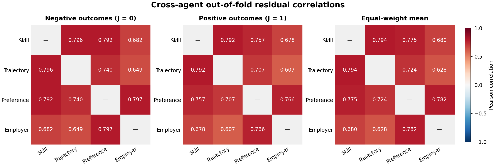

# 四个评审角色的共同错误

在校准集 C 的 128 名求职者中，每个角色对同一份十岗名单估计联合事件 J。下表使用按人三折得到的样本外概率。负例层中，正相关表示两位角色高估概率的程度往往同步。正例层中，正相关表示两位角色低估概率的程度往往同步。两类分别计算，再等权平均。

| 角色对 | J=0 人数 / 岗位数 | ρ₀ [95% 区间] | J=1 人数 / 岗位数 | ρ₁ [95% 区间] | 等权均值 ρ [95% 区间] |
|---|---:|---:|---:|---:|---:|
| Skill × Trajectory | 128 / 986 | 0.796 [0.762, 0.828] | 112 / 294 | 0.792 [0.724, 0.849] | 0.794 [0.754, 0.829] |
| Skill × Preference | 128 / 986 | 0.792 [0.758, 0.821] | 112 / 294 | 0.757 [0.689, 0.811] | 0.775 [0.734, 0.807] |
| Skill × Employer | 128 / 986 | 0.682 [0.620, 0.716] | 112 / 294 | 0.678 [0.572, 0.753] | 0.680 [0.607, 0.721] |
| Trajectory × Preference | 128 / 986 | 0.740 [0.701, 0.772] | 112 / 294 | 0.707 [0.627, 0.768] | 0.724 [0.677, 0.759] |
| Trajectory × Employer | 128 / 986 | 0.649 [0.570, 0.691] | 112 / 294 | 0.607 [0.496, 0.686] | 0.628 [0.552, 0.676] |
| Preference × Employer | 128 / 986 | 0.797 [0.745, 0.827] | 112 / 294 | 0.766 [0.672, 0.831] | 0.782 [0.716, 0.822] |

负例层中，Preference × Employer 的高估程度相关点估计最高（0.797）。正例层中，Skill × Trajectory 的低估程度相关点估计最高（0.792）。等权均值最小的是 Trajectory × Employer（0.628）。这些次序描述本次点估计，角色对之间的差值没有单独检验。

区间为 2,000 次折内求职者 bootstrap 的第 2.5、97.5 百分位，随机种子为 20261121。每次抽取整位求职者的十岗和四角色共同头，每一折保持原人数，在另外两折重新拟合共同头温度。在原样本触发退化规则的分层标为 NA。替代值按冻结规则参与合成均值。[逐对数值及退化原因](correlated_error_pairs.csv)

## 从可靠度到相关错误降权

| 角色 | 样本外 Brier | 相关惩罚分母 | T0 权重 | T1 权重 | 变化（百分点） |
|---|---:|---:|---:|---:|---:|
| Skill | 0.21354 | 3.2487 | 26.016% | 25.546% | -0.470 |
| Trajectory | 0.20222 | 3.1461 | 27.222% | 27.602% | +0.380 |
| Preference | 0.23525 | 3.2799 | 23.852% | 23.199% | -0.653 |
| Employer | 0.24533 | 3.0898 | 22.909% | 23.653% | +0.743 |

六组均值相关中有 6 组为正。各角色的可靠度除以各自的惩罚分母后，再在四角色之间归一化。Preference 的相对权重下降最多（-0.653 个百分点），Employer 的相对权重上升最多（+0.743 个百分点）。第 6 期使用 T1−T0 的配对比较检验这一步是否改善测试排序。[四角色权重明细](role_weights.csv)

原样本 12 个分层统计中退化 0 个。2,000 次重采样合计触发 0 次分层退化。完整重采样序列、逐折温度和系数保存在同目录的 `bootstrap.npz`。
